# Understanding the Geography of Healthcare Access in South Africa

## Evaluating Pharmacy Access in Gauteng and KwaZulu-Natal Under the National Health Insurance Act

**MUSA Smart Cities Practicum | Spring 2026**

**Team:** Joey Cahill, Jillian Kalman, Alex Stauffer, Tess Vu

**Instructors:** Michael Fichman & Matthew Harris

**Client:** Distributed AI Research Institute (DAIR)
Raesetje Sefala (Researcher) | Nyalleng Moorosi (Research Fellow)

## Background

### The National Health Insurance Act and Healthcare Access

The catalyst of this project starts with a new healthcare policy passed by the South African parliament that intends to expand public healthcare services, fixing what is currently an imbalanced system. Right now, public and private medicine funding is split 50/50 by the government. However, the public health system serves over 80% of the population, whereas private pharmacies serve about 20% (Mkhize N.I., 2026). The inefficiency of this system on the supply and demand of medicines has led to a number of social repercussions like lower than average vaccination rates and higher than average rates of communicable diseases (Aweeka 2025). This new bill seeks to bridge the gap between private and public disparities by making public health insurance acceptable in private pharmacies where supply is at a surplus.

The National Health Insurance (NHI) Act of 2024 represents a landmark transformation in South African healthcare policy, establishing a public fund to subsidize the provision of care and medicines across the nation. This legislation aims to address the profound inequalities in healthcare access that persist nearly three decades after the end of apartheid, creating a universal healthcare system that theoretically enables all South Africans to receive quality healthcare services regardless of their socioeconomic status (Ramaphosa, 2024).

The passage of the NHI Act has prompted critical questions about implementation readiness, particularly regarding the spatial distribution of pharmaceutical services. While the NHI creates funding mechanisms for healthcare provision, its success depends fundamentally on whether populations can physically access healthcare infrastructure, including pharmacies where they can obtain prescribed medications. This spatial dimension of healthcare access is not uniformly distributed across South Africa and reflects historical patterns of development, urbanization, and the enduring legacy of apartheid-era spatial planning.

### The Legacy of Apartheid Geography

The precursor of this pharmasocial imbalance is the persistent legacy of Apartheid in South Africa that was officially stripped of use in the 1990s. During this relatively short period of time, political power was consolidated to the white minority settlers who were motivated by racism and hierarchy in how they ran the country. Native Black African populations were stripped of voting rights, land ownership rights, and the ability to hold office. While segregation is no longer written in the South African constitution, the forced restructuring and separation that Apartheid instilled has continued to influence infrastructural development, the movement of people, and ideological beliefs to this day. The activists and authors behind this new healthcare policy are interested in expanding pharmaceutical access to the average South African to improve both individual health outcomes and societal public health outcomes.

With this, understanding healthcare access in contemporary South Africa requires grappling with the historical geography of apartheid. Crucially, the Group Areas Act of 1950 and subsequent legislation systematically segregated residential areas by Population Group, concentrating Black African and Coloured populations in townships and homelands while reserving well-serviced urban areas for White residents. As an intended consequence, this spatial engineering created patterns of uneven development that persist today as former township areas often lack the commercial infrastructure, including pharmacies, that developed in historically white areas (Johnson-Castle, 2014).

The spatial mismatch between where people live and where services are located represents a fundamental challenge for NHI's smooth implementation. Populations in former township areas and informal settlements may need to travel considerable distances to access pharmacy services that creates barriers which are particularly acute for the elderly, disabled, and those without private transportation. The informal economy possesses a substantial portion of South Africa's workforce, further compounds and complicates access patterns, as workers may have limited time flexibility for healthcare visits (McLaren, Ardington & Leibbrandt, 2014).

### Research Motivation and Client Context

The Distributed AI Research Institute's (DAIR's) interest stems from their broader research agenda examining how data-driven technologies can be deployed to understand and address social inequalities rooted in social ethics. The organization has previously conducted influential research on spatial apartheid, developing datasets and analytical frameworks for studying the persistent spatial inequalities in South African settlements (Sefala et al., 2021).

This project builds on DAIR's established expertise while extending their analytical framework to healthcare infrastructure. By creating a well-documented, replicable methodology for two pilot provinces, the research provides a foundation that DAIR, should they desire, could expand and generalize to evaluate pharmacy access across all nine South African provinces.

### Research Questions

The historical significance of South African society is what will be used to inform the analysis and the features chosen for the final product. The problem in its purest form is an inequitable access to essential medicines asserted by unorthodox geospatial design and privatized healthcare. This project measures and quantifies accessibility to pharmacies to answer the questions:

1.  What is the spatial distribution of pharmacies in Gauteng and KwaZulu-Natal?
2.  What populations have adequate access to pharmacy services, and what populations face access barriers?
3.  To what extent do patterns of pharmacy access correlate with historical geographies of apartheid?

The following report will detail how access to pharmacies are defined, the methodology behind the metrics, the instruments used to deploy the application, and the data that was collected to illustrate the findings.

---

## Study Area

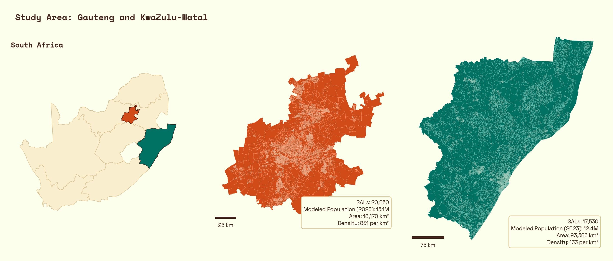

*The two study provinces and their SALs.*

### Gauteng Province

Gauteng, South Africa's smallest province by area but most populous contains approximately 16 million residents representing roughly 26% of the national population. The province encompasses the cities of Johannesburg, Pretoria (Tshwane), and the East Rand (Ekurhuleni), which forms the economic beating heart of South Africa and the broader Southern African region.

The province's spatial structure reflects its mining and industrial heritage as Johannesburg developed around gold mining operations with segregated residential areas creating the townships of Soweto, Alexandra, and numerous smaller settlements. Pretoria, which was established as an administrative center, displays similar patterns of racial residential segregation. The East Rand industrial corridor connects these major centers while incorporating additional township complexes.

Gauteng's economic centrality creates complex healthcare access dynamics because while the province has relatively high pharmacy density overall, the distribution is uneven. Historically white suburbs contain concentrations of commercial pharmacy services, while township areas and informal settlements often have limited pharmacy presence, requiring residents to travel to commercial centers for pharmaceutical services.

### KwaZulu-Natal Province

KwaZulu-Natal, located on South Africa's eastern coast has approximately 12 million residents, making it the second most populous province. In juxtaposition to Gauteng, this province displays greater geographic diversity, encompassing coastal urban areas around Durban (eThekwini), extensive rural areas, and former homeland territories that were designated as independent states during apartheid (Lawal, 2025).

The city of Durban serves as the provincial economic center and contains South Africa's largest port. However, unlike Gauteng's concentrated urbanization, KwaZulu-Natal has substantial rural populations, including communities in former KwaZulu homeland areas where they face healthcare access challenges that are distinct from urban townships, including greater distances to healthcare infrastructure and limited transportation options.

The contrast between Gauteng and KwaZulu-Natal provides methodological advantages for this research. By developing approaches that work across both a highly urbanized province and one with significant rural populations, the methodology of measuring access to both of them demonstrates generalized applicability, coupled with human decision-making, to the diverse geographic contexts present across South Africa.

### Administrative Geography

South Africa's administrative hierarchy structures the geographic analysis. The nine provinces divide into either metropolitan municipalities (for major urban areas) or district municipalities (for other areas). District municipalities further subdivide into local municipalities. For census purposes these administrative units contain wards that serve as the smallest geographic unit for which 2023 Census data are available.

Wards are population-scaled units, meaning that rural wards cover much larger geographic areas than urban wards while containing similar population counts. This creates analytical challenges in that rural wards may encompass multiple dispersed settlements with varying access to pharmacy services, while urban wards represent more spatially concentrated populations.

Below the ward level, Small Area Layers (SALs) provide finer geographic resolution but are only available from the 2011 Census. SALs contain approximately 500 households each, providing a scale more appropriate and granular for local accessibility analysis but requiring methodological approaches to estimate current populations from decade-old data.

---

## Literature Review

### Spatial Accessibility in Healthcare Research

Clinicians and researchers have been measuring healthcare access for decades. Typically, researchers find that rural, low-income areas are the most vulnerable to being under-served in access to healthcare. This is because remoteness is working against them. Most research indicates a 20-30 minute commute for healthcare is considered reasonable, which is hard to achieve in rural areas. In countries where the cost of healthcare is increasing, this gap of access continues to increase, and is exacerbated by spatial context (Murphy and Rodis 2025). Healthcare accessibility is often simplified to 'living near health services', but this is been proven over time to be insufficient, especially when using Euclidean distance. Variables like supply and infrastructure are overlooked in this method (McClaren et al. 2014). Overtime, researchers have developed a method called Enhanced Two-Step Floating Catchment Area method. This is a gravity-based model that measures access through time-traveled, supply capacity, and the role of demand. This will be explored in the methodology. Accessibility to pharmacies is crucial for public health: it promotes medication adherence, increases health education/awareness, and normalizes vaccination and testing behaviors (L Berenbrok 2022).

### South African Spatial Research Context

Apartheid is rightfully at the center of spatial research in South Africa and the motivation behind this research. Although near 40 years in the past, inequalities still persist on many fronts (Lowal 2025). With the work of DAIR, they seek to understand how apartheid has evolved over time into the mainstream culture and society of South Africa today. Because of the manufactured nature of apartheid, South Africa requires different classifications than just urban/suburban/rural that are often found around the world in some iteration. These concepts are present in SA, but are broken down into a more fine-grained subdivision based on their historical context that is not found anywhere else. Neighborhood types such as townships and informal residential have been introduced to this research using thousands of high resolution satellite imagery and integrated into detailed datasets by DAIR. They also collected spatial data on economic class (wealthy/non-wealthy), land use (industrial/commercial/residential), and building density. DAIR plans to continue this research to understand the standard of living and demographic make-up of South Africa as time goes forward (R Sefala 2024).

### Pharmacy Regulation and Trade in South Africa

Pharmacies are regulated by the South African Pharmacy Council (SAPC), constituted of a 25-member collective of pharmaceutical professionals. SAPC is an independent, self-funded, statutory body mandated in terms of the Pharmacy Act, 53 of 1974 to regulate the pharmacy profession in the country with powers to register pharmacy professionals and pharmacies, control of pharmaceutical education, and ensuring good pharmacy practice. They maintain multiple committees and allow you to search pharmacies or pharmacists that are recognized and approved by their regulations, including histories of inspections (pharmcouncil.co.za). Due to the gaps in the regulated pharmaceutical market, an illicit drug trade has emerged. Those who cannot access or are denied access to regulated medicine turn to illegal vendors and street markets to access things like antibiotics, contraceptives, and pain relievers. The consequences of widespread unregulated medicine include increased drug abuse/misuse, increased risk of adverse advents, and decreased rates of dosage adherence (Mutandiro 2025).

---

## Methodology

### Data Sources and Collection Strategy

The project assembles pharmacy location data from multiple sources, reflecting the fragmented nature of pharmacy information in South Africa, and unfortunately, no unified national database of pharmacies exists, requiring data integration across heterogenous sources.

#### Raw Data Inventory

**Geographic Boundary Data:**

| Dataset | Source | Date | Columns | Records |
|---------------|---------------|---------------|---------------|---------------|
| South Africa Wards | South African Census | 2023 | 12 | 4,468 |
| South Africa Small Area Layers (SAL) | South African Census | 2011 | 60 | 39,177 |

**Reference Lookup Tables:**

| Dataset | Description | Columns | Records |
|------------------|------------------|------------------|------------------|
| `CITY_PROVINCE_LOOKUP` | Mapping table linking cities/suburbs to provinces and municipality hierarchies for Gauteng and KwaZulu-Natal | 6 | 290 |

The `CITY_PROVINCE_LOOKUP` table was created to help with handling province assignment for pharmacy records lacking explicit province information, which contains mappings from city/suburb names to their corresponding PROVINCE, `LOCAL_MUNICIPALITY`, `DISTRICT_MUNICIPALITY`, `METROPOLITAN_MUNICIPALITY`, and `CITY` values. This lookup supports the multi-stage address matching process described in the data processing pipeline.

**Network Data:**

| Dataset | Source | Resolution/Format | Description |
|------------------|------------------|------------------|------------------|
| OSMnx Pedestrian Network | OpenStreetMap via OSMnx | Vector network (nodes/edges) | Walkable street network for pedestrian accessibility calculations |
| OSMnx Drive Network | OpenStreetMap via OSMnx | Vector network (nodes/edges) | Road network for driving accessibility calculations |

-   The OSMnx pedestrian and drive networks are extracted from OpenStreetMap for both provinces, enabling network-based distance calculations to pharmacies as specified by the client.

**Private Health Insurance Provider Networks:**

Private health insurance providers publish lists of pharmacies in their preferred provider networks. These lists, while not comprehensive of all pharmacies, provide extensive coverage of commercially operating pharmacies:

| Dataset | Source URL | Date | Records |
|------------------|------------------|------------------|------------------|
| GEMS Gauteng Pharmacies | <https://www.gems.gov.za/Healthcare-Providers/GEMS-Network-of-Healthcare-Providers/Primary-Network/Pharmacy> | February 2026 | 890 |
| GEMS KZN Pharmacies | <https://www.gems.gov.za/Healthcare-Providers/GEMS-Network-of-Healthcare-Providers/Primary-Network/Pharmacy> | February 2026 | 571 |
| Wooltru Gauteng Pharmacies | <https://www.wooltruhealthcarefund.co.za/static-assets/siteFiles/WHF_Pharmacy_Network_list_2024_GAU.pdf> | January 2024 | 734 |
| Wooltru KZN Pharmacies | <https://www.wooltruhealthcarefund.co.za/static-assets/siteFiles/WHF_Pharmacy_Network_list_2024_KZN.pdf> | January 2024 | 403 |
| Momentum Gauteng Pharmacies | <https://www.multiply.co.za/engaged/independent-pharmacies/> | Undated | 169 |
| Momentum KZN Pharmacies | <https://www.multiply.co.za/engaged/independent-pharmacies/> | Undated | 109 |
| Vitality Wellness Pharmacies (All Provinces) | <https://www.discoveryhealthmedicalscheme.co.za/wcm/discoverycoza/assets/vitality/wellness-network/pharmacy-list.pdf> | Undated | 3,077 |
| SAMWUMED Pharmacies (All Provinces) | <https://www.samwumed.org/our-networks/samwumed-pharmacy-list/> | Undated | 3,161 |

**Total Raw Private Pharmacy Records:** 9,114

**Government Hospital Data:**

| Dataset             | Source                       | Date    | Records |
|---------------------|------------------------------|---------|---------|
| Hospital Pharmacies | DAIR Institute (pre-cleaned) |  2026   | 272     |

Public hospitals contain pharmacies that dispense medications to patients, and location data from government sources confirmed by the DAIR Institute provides coordinates for these public pharmacy access points, though not detailed address information—private pharmacies, on the other hand, lack coordinates, but have detailed address information.

**SAPC Registry (Scraped):**

| Dataset | Source | Date | Records |
|---|---|---|---|
| SAPC Active Pharmacies — Gauteng | South African Pharmacy Council Registry | February 2026 | 1,961  |
| SAPC Active Pharmacies — KwaZulu-Natal | South African Pharmacy Council Registry | February 2026 | 894  |

The South African Pharmacy Council maintains a registry of all registered pharmacies at pharmcouncil.co.za. Unlike the insurance network lists, which only include pharmacies participating in specific provider agreements, the SAPC registry represents the full population of legally registered pharmacies. Records were collected programmatically via a trie-based web scraper that submitted search queries for every 3-character alphabetical prefix within each province and fetched detail pages for Active pharmacies to retrieve full address, owner, responsible pharmacist, license number, and inspection history. Inactive and Erased records are retained with table-level data only. The process is documented in `01_sapc_scraper.ipynb`.

*SAPC Source Limitations:* The registry reflects registration status at the time of query, so pharmacies registered when the insurance network data was collected may have subsequently been deregistered, or vice versa. Detail pages are only accessible within the same browser session that executed the search, meaning the scraper must fetch detail pages immediately during the search loop rather than in a separate pass. Pharmacies with Inactive or Erased status are retained in the raw output with table-level data only and are excluded during the master file build. Additionally, the registry search has a minimum of 3-character prefix enforcement, meaning pharmacies with very short names may require multiple prefix expansions to be captured.

**Data Extraction Methods:**

-   **PDF Conversion:** GEMS, Wooltru, and Vitality pharmacy lists were converted from PDF to tabular format using Adobe Acrobat text extraction.
-   **HTML Table Copy:** Momentum pharmacy data was copied directly from the provider website where it was already displayed in table format.
-   **CSV Download:** SAMWUMED provided direct CSV download functionality from their website.
-   **Web Scrape:** SAPC records were accessed via a python scraper which queried a search function hosted on their website.

#### Final Transformed Data

The final pharmacy data is summarized here; field-level detail for the SAL-level dataset is in [`../docs/data-dictionary.md`](../docs/data-dictionary.md). In brief, the pipeline consolidates 9,114 raw private pharmacy records and 272 hospital records into `PHARMACIES_COMBINED` (5,436 records after cleaning, standardization, and province filtering), then layers the SAPC registry on top of the geocoded records, deduplicates, and validates spatially to produce `PHARMACIES_MASTER_FINAL.csv` (2,152 records), the input to all accessibility analysis.

**Data Source Limitations:**

-   **Network Participation Bias:** Pharmacies must participate in at least one of the insurance networks to appear in the dataset, meaning independent pharmacies serving primarily uninsured or cash-paying populations may be systematically underrepresented.
-   **Temporal Inconsistency:** Source data spans from January 2024 to February 2026 with some sources undated, so pharmacies may have opened, closed, or relocated during this period, creating potential staleness.
-   **PDF Extraction Errors:** Text extraction from PDF documents using Adobe Acrobat and automated text-extraction tools may introduce errors or formatting artifacts that could affect geocoding accuracy for example.
-   **Missing Identifiers:** Momentum and Vitality sources lack `PRACTICE_NUM` identifiers, preventing deduplication for approximately 1,500 records.
-   **Hospital Data Gaps:** Hospital records contain coordinates but lack street addresses, limiting cross-validation capabilities and preventing address-based quality checks.

**Validation Sources:**

-   **SAPC Registration Database:** The South African Pharmacy Council provides a searchable database for verifying pharmacy registration status (<https://pharmcouncil.co.za/Pharmacies_Overview>)
-   **Google Places API:** Provides geocoding services and place verification for pharmacy locations

### Data Processing Pipeline

Pharmacy source data was ingested and cleaned in Snowflake, producing `PHARMACIES_MASTER_FINAL.csv`, the authoritative pharmacy list that feeds every accessibility calculation. All SAL-level processing, such as population downscaling, network routing, accessibility scoring, and the combined access table, ran in eight Python notebooks, executed in strict sequential order.

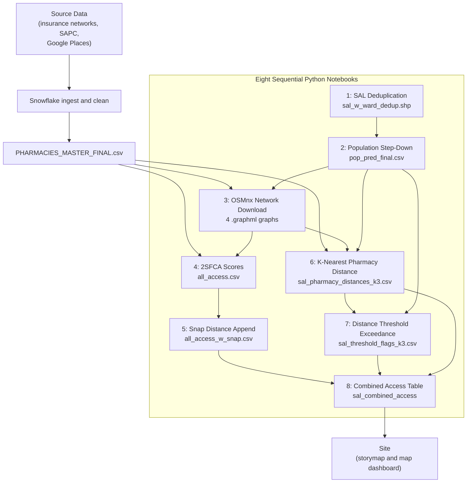

*The pipeline from source data to the site.*

#### Notebook 1: SAL Deduplication

**Purpose:** Remove duplicate SAL rows introduced by the ArcGIS Pro ward spatial join.

**Inputs:** `sal_w_ward_new.shp` (SAL polygons joined to 2020 ward boundaries).

**Outputs:** `sal_w_ward_dedup.shp` (38,380 unique SALs, EPSG:32735).

**Key findings:**

- Of 39,177 input features, 37,610 SAL codes appear once, 748 twice, and 22 three or more times.
- All 770 duplicate groups carry identical ward assignment, area, geometry, and attribute values, so deduplication loses no analytical information.

#### Notebook 2: Population Step-Down Model

**Purpose:** Estimate each SAL's 2023 population by apportioning its ward's 2022 Census total by the SAL's 2011 population share.

**Inputs:** 2011 SAL census boundaries, 2020 ward boundaries, 2022 ward population totals, and the deduplicated SAL-ward join.

**Outputs:** `pop_pred_final.csv` (38,380 rows).

**Key findings:**

- Total estimated 2023 population: 27,523,308, exactly matching the ward 2022 Census totals.
- Mean SAL population 717; median 667; maximum 13,852.
- 1,270 SALs have zero estimated population (no dwellings enumerated in 2011).

#### Notebook 3: OSMnx Network Download

**Purpose:** Download walk and drive network graphs for each province and compute Euclidean baseline distances.

**Inputs:** Deduplicated SAL polygons, population estimates, and the geocoded pharmacy list.

**Outputs:** Four `.graphml` network graphs (Gauteng and KZN, walk and drive).

**Key findings:**

- Gauteng walk 443,832 nodes / 1,219,312 edges; drive 279,004 / 730,792.
- KZN walk 541,204 / 1,356,318; drive 311,426 / 749,194.

#### Notebook 4: Two-Step Floating Catchment Area (2SFCA)

**Purpose:** Compute the Enhanced 2SFCA accessibility score for every SAL.

**Inputs:** Population estimates, pharmacy locations, SAL polygons, and the network graphs.

**Outputs:** `all_access.csv` (38,380 rows with `wlk_ai` and `drv_ai`).

**Key findings:**

- The walking score is zero for 53.2% of Gauteng SALs and 74.3% of KZN SALs.
- The driving score is zero for 38.7% of Gauteng SALs and 58.8% of KZN SALs.
- The score distribution is heavily right-skewed.

#### Notebook 5: Snap Distance Append

**Purpose:** Quantify the centroid-to-network-node snap gap as a data-quality diagnostic.

**Inputs:** 2SFCA scores, SAL polygons, and the network graphs.

**Outputs:** `all_access_w_snap.csv` (38,380 rows with `wlk_snap_m` and `drv_snap_m`).

**Key findings:**

- KZN Farm SALs have 59.9% flagged above the 500 m snap threshold; KZN Traditional SALs 20.4%; urban SALs in either province under 1%.
- KZN walk flags 2,149 SALs (12.3%); KZN drive flags 2,884 (16.5%).

#### Notebook 6: K-Nearest Pharmacy Distance

**Purpose:** Compute each SAL's distance to its three nearest pharmacies by Euclidean, walk, and drive methods.

**Inputs:** SAL polygons, population estimates, pharmacy locations, and the network graphs.

**Outputs:** `sal_pharmacy_distances_k3.csv` (38,380 rows).

**Key findings:**

- 4,931 SALs (12.8%) have no walk path within 50 km; 5,001 (13.0%) have no drive path.
- Euclidean k=1 distance: median 1.35 km, mean 4.47 km.

#### Notebook 7: Distance Threshold Exceedance

**Purpose:** Apply binary policy thresholds to the k-nearest distances.

**Inputs:** k-nearest distances and population estimates.

**Outputs:** `sal_threshold_flags_k3.csv` (38,380 rows with flags) and `threshold_summary_k3.csv`.

**Key findings:**

- At 3 km walk (k=1), 16.5% of Gauteng SALs exceed the threshold versus 61.3% of KZN SALs.
- At 10 km drive (k=1), 1.9% of Gauteng SALs exceed versus 35.6% of KZN SALs.
- In Gauteng, the k=3 redundancy gap at 3 km walk is 22.6 percentage points (16.5% k=1 versus 39.1% k=3).

#### Notebook 8: Combined Access Table

**Purpose:** Merge the three analytical streams into a single SAL-level dataset with the access typology, data-quality flags, and age bands.

**Inputs:** 2SFCA scores with snap distances, k-nearest distances, threshold flags, and SAL geometry.

**Outputs:** `sal_combined_access.csv` and a shapefile (38,380 rows).

**Key findings:**

- All four source tables share the identical 38,380 SAL-code set (no orphans).
- The access typology crosses the score tier with the distance threshold to produce six classes.
- Snap distance flags mark SALs above 500 m.

### Population Data and Downscaling: Step-Down Methodology and Dasymetric Mapping

This approach estimates small-area population counts for 2023 (SAL-level) using a combination of 2011 SAL population data, 2023 ward-level projections, and spatial weighting. Using the Step Down Projection Method: It leverages population growth patterns and land weights to distribute ward-level counts to finer spatial units.

Only population is apportioned from Wards; Population Group, age, and dwelling counts remain 2011 SAL-level Census values.

#### SAL Deduplication (Preprocessing)

The ArcGIS Pro spatial join that assigned SAL polygons to 2020 ward boundaries produced multiple rows per SAL where join artifacts created identical copies. Of 39,177 input features, 37,610 EA_CODEs appear once, 748 appear twice, and 22 appear three or more times. Five diagnostic checks confirm all 770 duplicate groups carry identical ward assignment, area, geometry, and all attribute values. Deduplication via `drop_duplicates(subset="EA_CODE", keep="first")` produces 38,380 unique SAL records with no analytical information lost. This deduplicated shapefile (`sal_w_ward_dedup.shp`, EPSG:32735) serves as the geometric foundation for all downstream notebooks.

#### Data Preparation

2011 SAL census shapefile (ea_sal_kzn_gp.shp) Already filtered to just Gauteng and KZN


2023 Ward shapefile and population (SA_Wards2020.dbf and census_ward_2023_with_pop.csv) These were joined on 'WardId'
| Column     | Type           |   Count |   Unique |
|:-----------|:---------------|--------:|---------:|
| Province   | object         |    1430 |        2 |
| Municipali | object         |    1430 |       53 |
| CAT_B      | object         |    1430 |       53 |
| WardNo     | int64          |    1430 |      135 |
| District   | object         |    1430 |       16 |
| DistrictCo | object         |    1430 |       16 |
| Date       | datetime64[ms] |    1430 |        2 |
| WardID     | object         |    1430 |     1430 |
| WardLabel  | object         |    1430 |     1430 |
| geometry   | geometry       |    1430 |     1430 |
| Total      | object         |    1430 |     1430 |

#### Spatial Joining and Tabulation
Using ArcGis: Tabulate Intersection--> Input Zone: 2011 SAL geometries

Input Class: 2023 Ward Geometries

This table identifies the ward(s) that each SAL encompasses, the percentage of the area of the ward that the SAL takes up, and the area (m sq.).
| EA_CODE        |  WardID        |AREA           | Percentage|
|----------------|----------------|----------------|----------|
| 50310001      | 52103001         | 6967088.20     | 99.99|
| 50310001      |52106004          | 28.807487153359173  |0.0004|
| 50310001      | 52106014          | 43.38680092706605  |0.0003|


This is joined back to the SAL layer by EA_CODE --> Summarize Table --> AREA==Maximum

| EA_CODE        |  WardID        |AREA           | Province | district|
|----------------|----------------|----------------|------------|---------------|
| 50310001      | 52103001         | 6967088     |    province| district|
| 58110038      |52606020          | 48373210  | province|    district|
| 76410132      | 74805033          | 15722398      | province| district|
| 53810017    |      52606020|     5720   |province |     district    |


Limitations: SALs where the ward share is evenly split between one or more wards lose some spatial meaning when it gets paired with the highest share ward since it does not reflect where people actually live inside the SAL/ward.

#### Density Calculations for weighting

As indicated by DAIR, South Africa census has a history up undercounting populations. There were 2,084 SALs with a null population, so to avoid perpetuating further underestimation, housing counts (`num_houses`) were used as a population proxy, which is then multiplied by three (average house size per SA census website). If the SAL had null/0 population and a house count of 0, their final population remained at 0.

<p align="center">Density=  2011 population count/ SAL area (km sq.)</p>

#### Areal-Weighted Dasymetric Mapping
We estimate ward-level 2011 counts by grouping at ward-level and summing SAL population counts. This is used to calculate the share of population the SAL contains within the ward 'share2011'.

<p align="center">share2011=  SAL 2011 Population / Ward 2011 Total</p>


An earlier iteration of the model implemented dasymetric mapping weights that combined population share with log-density: <p align="center"> Dasym weight= share2011 * density_log </p>


The log of density was used to calculate the weight for several reasons. The spatial data was extremely skewed, with some SALs being the size of one apartment building and some being entire farming communities. The log was used to capture *relative* density to avoid extreme over estimation.

**Final implementation:** In the cleaned pipeline (`newpred_clean.ipynb`), the dasymetric weight is set equal to `share2011` alone, without log-density re-weighting. This change was made because both `share2011` and `log_density` derive from `pop2011`, and combining them would double-count the 2011 population signal. The ward share sums are validated to equal exactly 1.000000 for every ward (pycnophylactic constraint), ensuring mass preservation.

Before calculating the final estimate with the weight, it is grouped by ward then normalized by the sum of SAL weights. This is to capture SAL population *relative* to its own Ward (our coarsest unit for which we have real counts). It avoids unrealistic overestimating in urban pockets and undue undercounting in rural areas.

Finally, 2023 Ward population counts were used with the dasymetric weights to estimate 2023 SAL level population projections <p align="center"> pop2023est = dasym weight × Ward 2023 population </p>


| Variable        | Value        |
|-----------------|-------------|
| WardID          | 59500022    |
| EA_CODE         | 59913668    |
| pop2011         | 1306.0      |
| PR_NAME           | KwaZulu-Natal |
| ward2011_sum    | 32132.0     |
| ward2023_pop    | 21793.913535|
| pop2023est      | 1225.25738  |
| EA_GTYPE        | Urban       |
| EA_TYPE         | Township    |
| econ_stat       | Non_Wealthy |
| num_houses      | 10.0        |
| area_km2        | 0.001971    |
| sal_dense       | 662594.713465|
| log_density     | 13.40392    |
| share2011       | 0.040645    |
| dasym_weight    | 0.05622     |
| growth_rt       | -0.005304   |

This SAL is a pocket of land roughly the size of one small to mid-size apartment building with 1306 people, giving it a density of 662,594 people/ kmsq.: Impossibly dense, yet here it is in black and white. If we used the absolute density in the dasymetric calculation, the 2023 estimate would be ~26,000 for one apartment building. But when using the log density, the estimate sits at a modest 1,225: reflecting realistic counts and the ward level decline in growth, as well.

#### Estimation Justification and Reinforcement

If the 2023 SAL estimates were properly dissolved into SAL zones, the difference between the 2023 Census ward counts and our SAL estimates should be extremely minimal; as demonstrated below. Our output for this equation is 0. <p align="center"> 2023 Ward Population Sum- 2023 SAL Estimate Sum </p>

Total estimated 2023 population across both provinces: 27,523,308. This exactly matches the sum of ward-level 2022 Census totals, confirming mass preservation. Mean SAL population: 717; median: 667; max: 13,852. There are 1,270 SALs with zero estimated population (SALs that were vacant with no dwellings in 2011).


### Geocoding and Coordinate Assignment

Address strings assembled in `PHARMACIES_COMBINED` require geocoding to assign geographic coordinates. The project uses the Google Places Text Search API as its primary geocoding engine, submitting structured query strings for each pharmacy and extracting the `place_id`, matched name, matched address, and latitude/longitude from the top result.

**Query Construction**

Each record's query string is assembled by concatenating available address components in the order: pharmacy name, street address, city, province, and the fixed suffix "South Africa." This format was chosen because the Text Search API performs best when the query resembles a natural language search rather than a raw address string, and including the pharmacy name substantially improves match precision in cases where multiple businesses share a building or street number. Records missing one or more components are handled gracefully, with the available fields concatenated and the missing ones omitted.

**API Execution**

Queries are submitted to the `place/textsearch/json` endpoint with a `type=pharmacy` filter to bias results toward pharmaceutical establishments. Each run is checkpoint-resumable: completed query strings are tracked in a checkpoint CSV and skipped on subsequent runs, allowing the extraction to be interrupted and restarted without re-querying completed records or incurring redundant API costs. A 0.2-second sleep between requests respects API rate limits. Progress is saved every 100 records. Each result is flagged with a `needs_review` boolean if the API returned a non-OK status, returned no `place_id`, or returned null coordinates.

**Hospital Coordinate Fill-In**

Pharmacies located within public hospital campuses frequently fail the Places Text Search because the hospital's primary listing dominates the result. For these records a name-based match is attempted against the government hospital shapefile: pharmacy names and hospital names are both cleaned by lowercasing, removing punctuation, and stripping generic institutional terms (hospital, clinic, medical, center), and a direct string match on the cleaned key transfers the hospital's coordinates to any pharmacy with an otherwise-null location. This fills a targeted subset of missing coordinates without requiring additional API calls.

**SAPC Integration and Coordinate Transfer**

Following geocoding of the insurance-network list, SAPC-registered pharmacies are fuzzy-matched to the geocoded records (described in detail under Registration Validation). A significant portion of SAPC records that failed to match are found to correspond to Places-only rows that were geocoded successfully: the same pharmacy exists in both datasets but under slightly different name spellings. In these cases the Places-derived coordinates are transferred to the SAPC row and the redundant Places row is removed, preserving the richer SAPC regulatory metadata while retaining the geocoded position.

**Spatial Validation**

All geocoded coordinates undergo a two-tier spatial check. The outer check flags any coordinate falling outside a South Africa bounding box (approximately 22°S to 35°S, 16°E to 33.5°E) as `outside_sa`. The inner check verifies that each coordinate falls within a buffered bounding box for its expected province: Gauteng (25.1°S–26.8°S, 27.4°E–29.2°E) and KwaZulu-Natal (26.7°S–31.2°S, 28.7°E–33.0°E), each expanded by approximately 5 miles to avoid discarding genuine pharmacies near province boundaries. Records failing the inner check receive a `outside_province` flag. Records with null coordinates are flagged as `no_coords`. A 5-mile buffer was chosen as a balance between catching genuine boundary pharmacies and excluding clearly mismatched geocodes.

**Re-Geocoding Passes**

Records flagged as `outside_province`, `outside_sa`, or `no_coords` undergo up to two re-geocoding attempts. The first pass applies a simplified query using only name, city, and province while omitting the street address, which is the most frequent source of geocoding errors for South African addresses and applies the spatial checks again to any returned result before accepting it. The second pass targets SAPC rows that emerged from the fuzzy match with no coordinates at all, using SAPC-specific field names. Both passes apply the spatial validation before updating the master record, ensuring that a re-geocoded result outside South Africa does not overwrite a previously null coordinate.

**Geocoding Limitations:**

- **Address Format Sensitivity:** South African addresses follow varied conventions including informal locality descriptors, postal codes used as location identifiers, and non-English place names. The Places Text Search interprets these inconsistently, and the top result may match to the correct suburb rather than the specific street address, resulting in centroid-level rather than building-level precision.
- **Same-Name Province Mismatch:** A common failure mode is a query returning a pharmacy in the correct chain but in the wrong province. For example, a Dis-Chem in Gauteng being returned for a KwaZulu-Natal query because the name match is stronger than the geographic signal. Spatial validation catches these cases, but the underlying record is left with null coordinates after re-geocoding unless the simplified query resolves it.
- **API Budget Constraints:** Google Places API billing limits the total number of queries feasible within the project budget. The checkpoint system and skip-on-resume pattern minimize redundant calls, but records that exhaust re-geocoding attempts without a valid in-province result remain in the master file with null coordinates and a `no_coords` spatial flag.
- **Coordinate Precision:** The Text Search API returns a single representative point per place, which for pharmacies in shopping centers or medical complexes may represent the complex entrance rather than the pharmacy unit. This introduces sub-block positional uncertainty that is generally acceptable for ward-level accessibility analysis but would affect any fine-grained network routing.
- **Hospital Name Matching Sensitivity:** The hospital coordinate fill-in relies on cleaned name string equality. Pharmacies with names that diverge substantially from their hospital's official name, for example, a private dispensary within a public hospital using a branded name, will not be captured by this method.

### Spatial Accessibility Calculation

Access metrics quantify the relationship between pharmacy locations and population distribution. The project implements multiple accessibility measures to allow for methodological comparison and dual-metric diagnostics, where each metric serves as a check on the other's failure modes. All spatial computations use EPSG:32735 (UTM zone 35S, meters). Pharmacy coordinates originate in WGS84 (EPSG:4326) and are projected for distance calculations.

#### Distance Metrics

**Straight-Line Distance (Euclidean):** The simplest approach calculates straight-line distance from population centroids to the nearest pharmacy using a scipy `cKDTree` built from projected pharmacy coordinates, providing a lower-bound baseline that ignores road networks entirely.

**Network Distance (Walking):** Walking network distance provides accessibility measures relevant for populations without vehicle access. The OSMnx "pedestrian" network type provides calculation of actual walking routes from SAL centroids to pharmacy locations, accounting for street network topology rather than assuming straight-line travel. This form of accessibility is particularly relevant for understanding access barriers for lower-income populations.

**Network Distance (Driving):** Network distance analysis calculates travel distance along the road network, which better represents actual travel requirements but assumes private vehicle access. Driving network data is extracted via OSMnx using the "drive" network type. Drive graphs are converted to undirected for Dijkstra routing, which slightly underestimates true drive distances in areas with one-way constraints, primarily affecting dense urban cores.

#### Enhanced Two-Step Floating Catchment Area (E2SFCA)

The project implements the Enhanced Two-Step Floating Catchment Area method with network-based routing and negative exponential distance decay, providing a supply-demand perspective that captures competition between pharmacies and populations rather than purely distance-based measures.

**Distance decay function:** Negative exponential decay with β = 0.0003:

```
f(d) = exp(-0.0003 × d)
```

This produces weight 1.000 at 0 m, 0.741 at 1 km, 0.549 at 2 km, 0.407 at 3 km, 0.223 at 5 km, and 0.050 at 10 km. The parameter was selected to produce meaningful distance discrimination within the catchment range. An earlier version used β = 0.0001, which produced almost no decay (37% weight at 10 km) and was replaced.

**Step 1: Supply ratio ($R_{j}$):** For each pharmacy, single-source Dijkstra traversal outward on the road network up to the catchment cutoff identifies all reachable SAL centroids. The decay-weighted population of reachable centroids is summed, and the supply ratio is computed as:

```
Rj = 1000 / max(weighted_pop, MIN_WEIGHTED_POP)
```

where `MIN_WEIGHTED_POP = 50` prevents runaway ratios from pharmacies in sparsely populated catchments. The factor of 1000 is a scaling constant for readability. Without the population floor, a pharmacy with 3 people in its catchment produced $R_{j}$ = 333, creating scores 5,000x the mean.

**Step 2: Accessibility score ($A_{i}$):** For each SAL, single-source Dijkstra traversal outward on the road network sums the decay-weighted $R_{j}$ values from all reachable pharmacies:

```
Ai = Σ (Rj × f(d_ij))
```

where the sum is over all pharmacies j reachable from SAL i within the catchment cutoff.

**Province-specific catchment distances:**

| Province | Walk cutoff | Drive cutoff | Rationale |
|---|---|---|---|
| Gauteng | 2 km | 5 km | Dense, urban |
| KwaZulu-Natal | 3 km | 10 km | Sparse, mixed rural-urban; ~7x larger than Gauteng |

The walk and drive networks for each province are run separately, producing four province-mode combinations. The walking score is stored as `wlk_ai` and the driving score as `drv_ai`.

**Bug fixes applied during implementation:** (1) The original code used `.set_index("node")` to build the population lookup, silently dropping populations when multiple SALs snapped to the same road network node; the fix uses `.groupby("node").sum()` to aggregate all populations at shared nodes. (2) The MIN_WEIGHTED_POP = 50 floor was added to cap maximum $R_{j}$ at 20, preventing extreme outlier scores.

#### Snap Distance Analysis

When a SAL centroid snaps to a distant network node, the Dijkstra routing starts from a displaced origin, introducing systematic measurement error into both the 2SFCA and k-nearest distance results. To quantify this effect, the Euclidean distance between each SAL centroid and its nearest network node is computed for all four province-mode combinations.

| Province | Mode | Median (m) | Mean (m) | P95 (m) | Max (m) | Flagged >500m (%) |
|---|---|---|---|---|---|---|
| Gauteng | Walk | 57 | 83 | 223 | 25,702 | 232 (1.1%) |
| Gauteng | Drive | 67 | 101 | 290 | 26,962 | 398 (1.9%) |
| KZN | Walk | 83 | 226 | 985 | 9,951 | 2,149 (12.3%) |
| KZN | Drive | 102 | 302 | 1,318 | 8,435 | 2,884 (16.5%) |

Farm SALs in KZN have 59.9% flagged at the 500m threshold; Traditional SALs in KZN have 20.4%; Urban SALs in either province have less than 1%. This directly quantifies the differential quality of OpenStreetMap road network coverage across settlement types. SALs with snap distance exceeding 500m receive a binary flag in the final dataset, allowing downstream analysts to filter or weight results by data quality confidence.

#### K-Nearest Pharmacy Distance

The k-nearest distance metric captures absolute physical reachability rather than supply-demand competition. Distances from each SAL centroid to the 3 nearest pharmacies are computed using Euclidean, pedestrian network, and drive network methods.

k=1 captures basic reachability (can the community reach any pharmacy); k=2 captures redundancy (is there a fallback if the nearest pharmacy closes); k=3 captures choice (does a functioning local market exist rather than a single dependency point).

**Network routing:** Single-source Dijkstra from each pharmacy node individually, with a 50 km cutoff. For each SAL centroid (snapped to its nearest network node), the distances from all pharmacy sources are collected, sorted, and the 3 shortest are retained as k=1, k=2, k=3.

**Circuity ratio:** The ratio of network distance to Euclidean distance for k=1 is computed as a diagnostic. Values of 1.2–1.5 are typical for urban grids; values exceeding 3.0 suggest network data gaps or physical barriers (rivers, highways, rail lines). Gauteng walk median circuity is ~1.38, drive ~1.36, both consistent with international benchmarks.

**NaN handling:** 4,931 SALs (12.8%) have NaN walk distance at k=1 (no path within 50 km on the walk network); 5,001 SALs (13.0%) have NaN drive distance at k=1. These SALs are either genuinely isolated or in areas with sparse OSM coverage. Unreachable SALs count as beyond every threshold in the headline figures, but the stored exceedance flags are `false` for them (see Distance Threshold Exceedance).

#### Distance Threshold Exceedance

Binary policy thresholds answer: what proportion of SALs (and people) cannot reach their k-th nearest pharmacy within a given distance? This provides a policy-legible metric that avoids decay functions and provincial quantile comparisons.

For each combination of k level (1, 2, 3), transport mode (walk, drive), and threshold distance, a binary flag indicates whether the SAL exceeds the threshold. Flags follow the pattern `wk1_gt3km`, `dk1_gt10km`, and so on (mode `w` for walk or `d` for drive, k level, and threshold in kilometers).

**Thresholds applied:**

| Mode | Thresholds (km) |
|---|---|
| Walk | 1, 2, 3, 5 |
| Drive | 5, 10, 15, 20 |
| Euclidean | 1, 3, 5, 10 |

Exceedance rates are computed as both SAL-count proportions and population-weighted proportions (using `pop2023est`). Cross-tabulations are produced by province, geographic type (`EA_GTYPE`), and Wealth Class (`econ_stat`).

**Important caveat:** The stored exceedance flags are `false` for unreachable SALs (no pharmacy reachable within 50 km), so they undercount the true beyond-threshold population. Headline figures therefore use the Access Typology, or the explicit "distance above threshold or unreachable" condition, rather than these flags.

Province-level exceedance rates for the policy reference thresholds (3 km walking, 10 km driving) are reported in section A of the results.

#### Combined Access Table and Access Typology

The three analytical streams (2SFCA scores, k-nearest distances, threshold flags) are merged into a single SAL-level dataset. `EA_CODE` alignment is verified across all source tables (38,380 intersection, 0 orphans).

**Access Typology:** Each SAL receives a six-class Access Typology label, computed separately for walking (`wlk_type`) and driving (`drv_type`). The score tier — zero; bottom tercile of nonzero scores; above the bottom tercile, with terciles computed within province — is crossed with whether the nearest pharmacy is within the distance threshold (3 km walking, 10 km driving):

| Score tier | Nearest pharmacy within threshold | Nearest pharmacy beyond threshold |
|---|---|---|
| Zero | Connectivity Gap | Pharmacy Desert |
| Bottom tercile of nonzero | Demand Overcrowding | Access Gap |
| Above bottom tercile | Well-Served | Artifact Zone |

Access Gap and Artifact Zone have no SALs in the current data; the other four classes are populated in both provinces.

#### Accessibility Calculation Limitations

-   **Straight-Line Distance:** Assumes unobstructed travel in all directions, fails to account for barriers such as highways, rivers, railway lines, or fenced properties that may substantially increase actual travel distance. Urban areas with irregular street grids may have network distances much larger than straight-line distances.
-   **Network Distance (General):** Network quality depends on OpenStreetMap completeness, and informal roads, footpaths, and shortcuts common in township areas may be unmapped, overestimating travel distances for local residents.
-   **Driving Distance:** Assumes vehicle availability and ignores traffic congestion, parking availability, and fuel costs. Also fails to account for public transit options (minibus taxis) that may provide alternative access patterns. The dominant transport mode for the populations most likely to face pharmacy access barriers (low-income, non-vehicle-owning households in townships and traditional areas) is the minibus taxi, which is captured by neither the walk nor drive network.
-   **Walking Distance:** Standard walking speed assumptions (5 km/h) may not hold for elderly, disabled, or mobility-impaired populations, and also does not account for safety concerns, terrain difficulty, or weather conditions.
-   **2SFCA Zero-Inflation:** Walking $A_{i}$ is exactly zero for 53.2% of Gauteng SALs and 74.3% of KZN SALs. Not all zeros represent genuine pharmacy deserts: many arise from centroid-to-node snap displacement and catchment boundary edge effects. For Gauteng walk, 53.2% of SALs have zero $A_{i}$ but only 24.6% exceed 3 km to the nearest pharmacy; the 28-point gap quantifies the artifact fraction. The k-nearest distance metric serves as the diagnostic check on this failure mode.
-   **Uniform Supply Assumption:** All pharmacies are treated as having equal capacity (Sj = 1). A high-volume chain pharmacy with multiple pharmacists is weighted identically to a single-pharmacist dispensary. Pharmacy capacity data (staffing, dispensing volume, hours of operation) are not available.
-   **Province-Level Catchment Thresholds:** Catchment distances are set by province rather than by Settlement Type, creating a discontinuity at the province boundary: SALs on the KZN side receive larger catchments than adjacent SALs in Gauteng's East Rand despite comparable urbanization. A variable-catchment approach assigning thresholds by EA_GTYPE (Urban, Traditional, Farms) is the documented upgrade path.
-   **Decay Parameter:** β = 0.0003 was selected for analytical discrimination but is not empirically calibrated to South African travel behavior. Calibration would require observed pharmacy utilization data (patient origin-destination patterns).
-   **Threshold Arbitrariness:** Policy thresholds (3 km walk, 10 km drive) are reference points, not natural discontinuities. A SAL at 3.1 km is classified differently from one at 2.9 km despite near-identical access. The multi-threshold approach (four thresholds per mode at three k levels) mitigates this by showing the full exceedance curve.
-   **Population Centroid Assumption:** All methods calculate distance from geometric (unweighted) SAL centroids. For compact urban SALs, this closely approximates the population center. For large, irregular rural SALs (some exceeding 600 km² in KZN), the geometric centroid may fall in uninhabited terrain, introducing systematic measurement error that propagates through the entire pipeline.
-   **Province Boundary Truncation:** Road networks are downloaded by province and terminate at the provincial edge. SALs near province boundaries have their networks artificially truncated, forcing Dijkstra routing into within-province detours even if a pharmacy across the border is closer. In a national-scale deployment, this boundary effect disappears.

### Validation and Quality Assurance

Data quality assurance proceeds throughout the pipeline:

**Registration Validation:** SAPC registration status is validated through a fuzzy matching process that links each SAPC-registered pharmacy to its corresponding record in the Google Places-derived geocoded list. This matching serves two purposes: confirming that a pharmacy appearing in the insurance network lists is also registered with the SAPC (supporting legitimacy), and enriching geocoded records with regulatory metadata including Y-number, owner, responsible pharmacist, license number, registration date, and inspection history that the insurance sources do not contain.

Matching is performed at the province level: each SAPC record is compared only against geocoded candidates in the same province to reduce false positive risk. This restriction is enforced through a province normalization step that maps all province field variants (including abbreviations such as KZN and name fragments such as "Natal") to a canonical lowercase form before grouping.

The match score for each candidate pair is a weighted combination of name similarity and address similarity. Name similarity uses token sort ratio, which reorders tokens alphabetically before comparison to handle word-order variation (e.g. "Clicks Pharmacy Sandton" versus "Sandton Clicks"). Address similarity uses token set ratio, which identifies the common token subset and is more tolerant of partial address matches. These two scores are combined as:

`combined_score = 0.6 × name_score + 0.4 × address_score`

The 60/40 weighting reflects that name similarity is generally a stronger discriminator than address similarity for South African pharmacy records, where address formatting is inconsistent across sources. Both scores are computed on cleaned text with punctuation removed, all characters lowercased, and generic pharmacy-related terms stripped (pharmacy, pharm, chemist, apteek, dispensary, medical, clinic, and related variants) to prevent these ubiquitous words from inflating similarity scores between unrelated records.

A chain guard short-circuits matching to a score of zero for records belonging to confirmed but different retail chains. A curated list of major pharmacy chains (Dis-Chem, Clicks, Medirite, Alpha Pharm, Mopani, and others) is checked against both records before scoring. If both records are identified as chain pharmacies but under different chain names, the pair cannot be a match regardless of name similarity, preventing cross-chain false positives that would otherwise achieve high scores on generic words like "pharmacy" and "store."

Three confidence tiers are applied:

| Tier | Score Range | Disposition |
|---|---|---|
| `auto_match` | ≥ 80 | SAPC regulatory fields appended to geocoded record automatically |
| `review` | 70–79 | Record flagged for human inspection; treated as unmatched for master file build |
| `no_match` | < 70 | SAPC record routed to separate geocoding pass (`04_sapc_geocode_unmatched.ipynb`) |

The `match_type` field is preserved in all output files as an audit trail, allowing downstream users to filter to only automatically matched records or to inspect the borderline cases. The lowest-scoring auto-matches are surfaced in a preview table during the notebook run to support threshold calibration before export.

*Registration Validation Limitations:* The fuzzy match is sensitive to threshold selection. The auto-match threshold of 80 was chosen conservatively to minimize false positives at the cost of routing more records to the re-geocoding pass. Lowering the threshold would increase SAPC coverage but risk linking unrelated pharmacies. The province-constraint assumption that a pharmacy will have consistent province assignment across both the SAPC registry and the insurance network sources may not hold for pharmacies near province boundaries or for records with missing province data that were inferred through the city lookup table. Matching is also performed on a single best candidate per SAPC record: if the correct geocoded match is not in the top-scoring position due to address formatting, the record is routed to geocoding rather than matched.

**Spatial Validation:** Geocoded coordinates are verified against expected province boundaries where pharmacies geocoding outside Gauteng or KwaZulu-Natal boundaries require manual review.

**Duplicate Detection:** Post-geocoding spatial analysis identifies potential duplicates based on coordinate proximity (within 50-100 meters) combined with name similarity, addressing records that lack `PRACTICE_NUM` for identifier-based deduplication.

**Outlier Review:** Accessibility metrics are examined for outliers that may indicate data errors, like pharmacies in incorrect locations, or genuine access deserts requiring policy attention.

**Validation Limitations:**

-   **Registration Currency:** SAPC registration status reflects the time of query and pharmacies may have been registered when data was collected but subsequently deregistered, or vice versa.
-   **Spatial Proximity Thresholds:** The 50-100 meter threshold for duplicate detection is heuristic, so pharmacies in the same shopping center may legitimately be within this range, while geocoding errors may place duplicates further apart.
-   **Name Similarity Matching:** Fuzzy name matching for duplicate detection may produce false positives (different pharmacies with similar names) or false negatives (same pharmacy with variant name spellings across sources).
-   **Outlier Interpretation:** Extreme accessibility values may reflect genuine conditions (true access deserts or highly accessible areas) or data errors, and distinguishing these conditions require contextual investigation that may not be feasible at scale.

### Summary of Methodological Limitations

The methodology employed in this project involves multiple stages, each introducing potential sources of error that may propagate through the analysis pipeline. Key limitations are summarized below:

| Stage | Primary Limitation | Mitigation Strategy |
|----|----|----|
| Data Collection | Network participation bias, missing independent pharmacies | Cross-validation with Google Places API and SAPC registry |
| PDF Extraction | OCR errors in addresses | Manual review of geocoding failures, iterative address cleaning |
| Province Inference | Lookup table incompleteness | Iterative refinement based on dropped record review |
| Deduplication | Missing `PRACTICE_NUM` for \~1,500 records | Post-geocoding spatial deduplication, conservative retention |
| Geocoding | Variable coverage, address format inconsistency | Dual-source geocoding, confidence score filtering, re-geocoding passes |
| Population Step-Down | Frozen 2011 distribution assumption; 1,270 SALs with zero population regardless of post-2011 development | Multi-method comparison, flagging high-divergence areas |
| Centroid Placement | Geometric centroids in large rural SALs may fall in uninhabited terrain | Documented upgrade path: building-footprint-weighted centroids for SALs above 75th percentile in area |
| Network Coverage | OSM completeness varies by Settlement Type; province boundary truncation forces within-province detours | Snap distance diagnostic flags; national-scale deployment eliminates boundary effects |
| Transport Mode | No minibus taxi mode; walk overestimates difficulty, drive overestimates ease for target population | True access picture lies between walk and drive metrics; transit integration via GTFS is the upgrade path |
| 2SFCA Methodology | Province-level catchment thresholds create boundary discontinuity; uniform pharmacy capacity; uncalibrated decay parameter | Variable-catchment by EA_GTYPE (code exists, commented out); MIN_WEIGHTED_POP = 50 floor applied |
| Pharmacy Data Coverage | Private-sector and government-employee sources only; clinic dispensaries and mobile units excluded | Conservative (pessimistic) view of access; actual medication access points likely higher |
| Threshold Analysis | Binary cut at policy thresholds ignores near-threshold equivalence | Multi-threshold approach (four thresholds per mode at three k levels) shows full exceedance curve |

Users of this analysis should interpret results as indicative rather than definitive, particularly in areas where multiple limitations may compound. In this regard, policy decisions should be informed by but not solely determined by these accessibility measures, with ground-truthing recommended for priority intervention areas.

---

## Exploratory Data Analysis

### Pharmacy Distribution

| Province         | Count |
|:-----------------|------:|
| Gauteng          | 1,453 |
| KwaZulu-Natal    |   699 |
| **Total**        | **2,152** |

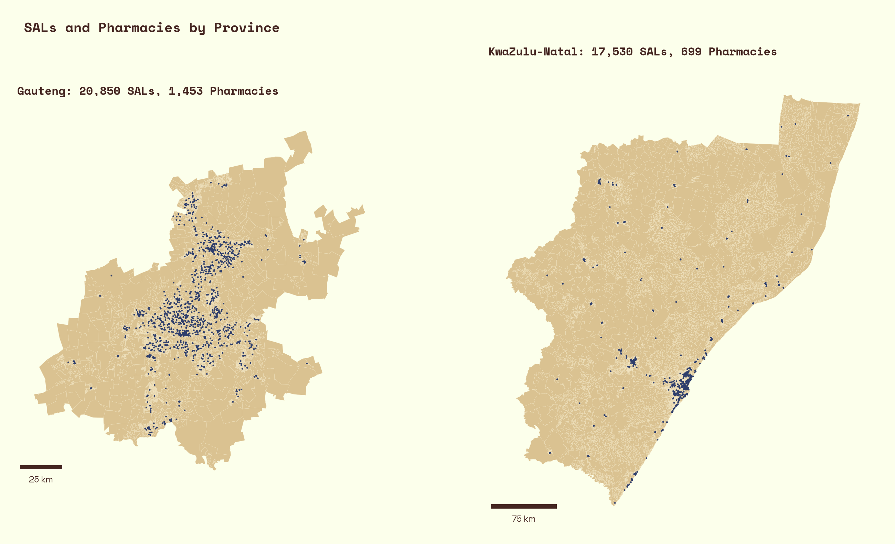

*SALs and pharmacies in each province.*

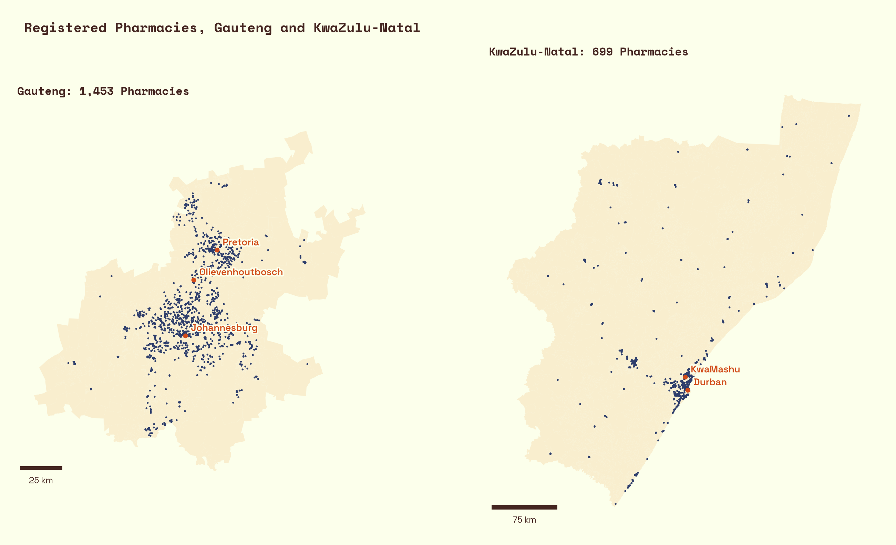

*Registered pharmacy locations by province.*

| Franchise                   | Count |
|:------------------------|------:|
| Other Independent       | 1,264 |
| Clicks                  |   380 |
| Independent/Unknown     |   156 |
| Dis-Chem                |   155 |
| Department of Health (Public)  |    72 |
| Shoprite Checkers       |    58 |
| Netcare                 |    27 |
| Life Pharmacy           |    15 |
| Pure Pharmacy           |    13 |
| Cornerstone Pharmacies  |     5 |
| Magoveni Health Group   |     4 |
| Thakeng Group           |     3 |
| **Total**               | **2,152** |

### Population Characteristics

The two study provinces hold 27.5M Modeled Population residents: 15.1M in Gauteng and 12.4M in KwaZulu-Natal. Population Group figures use the 2011 Census and are shown per province, not for South Africa as a whole.

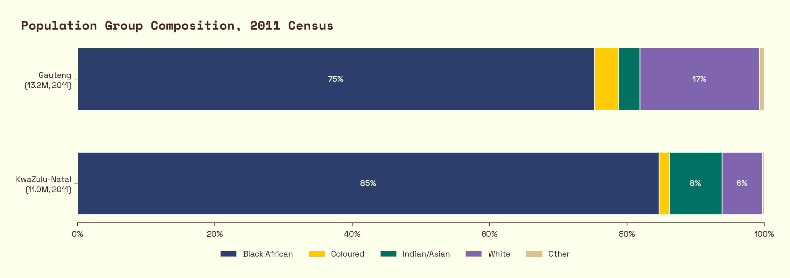

*Population Group composition of each province, 2011 Census. Source: Stats SA 2011 Census.*

### Mapping the Estimates

#### Modeled Population (2023)

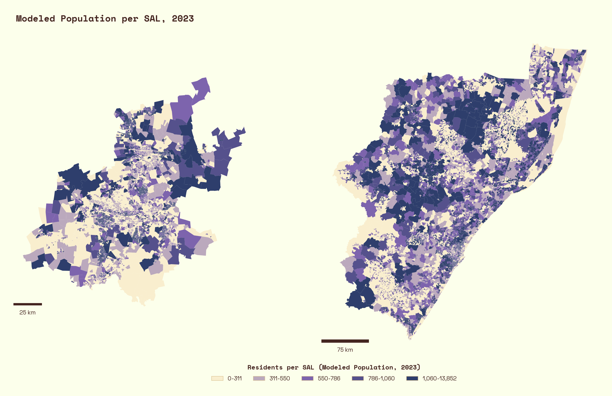

*Modeled Population per SAL, 2023, shown in quintiles.*

#### Population Density (2023)

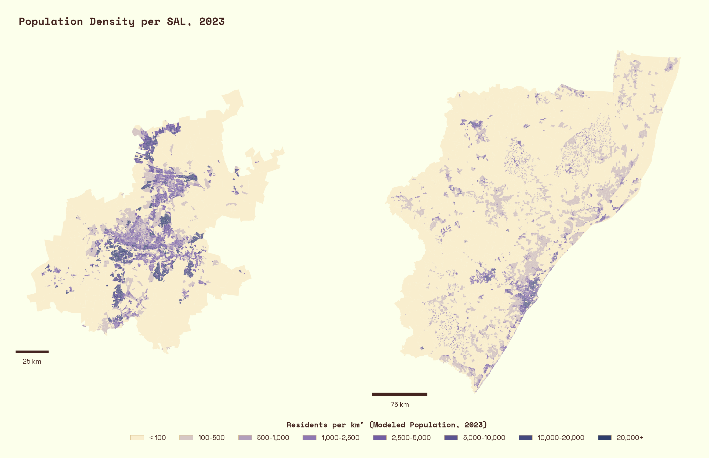

*Population density per SAL, 2023.*

#### Zooming into Johannesburg

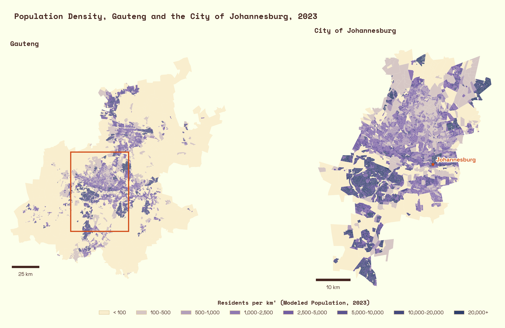

*Population density in Gauteng and the City of Johannesburg.*

#### Density by Settlement Type

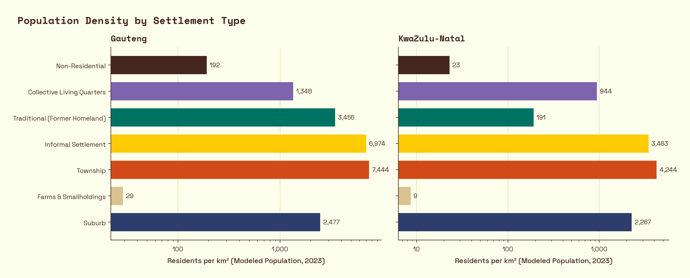

*Population density by Settlement Type and province.*

#### Growth Rate

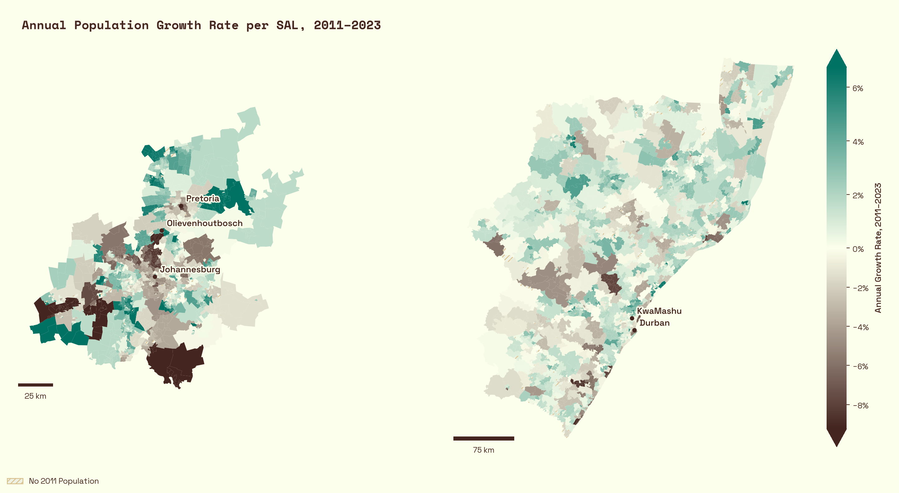

*Annual population growth rate per SAL, 2011–2023.*

### Accessibility Patterns

The bivariate map shows the relationship between walking and driving access scores, which are only weakly aligned in the rural SALs where the two modes diverge.

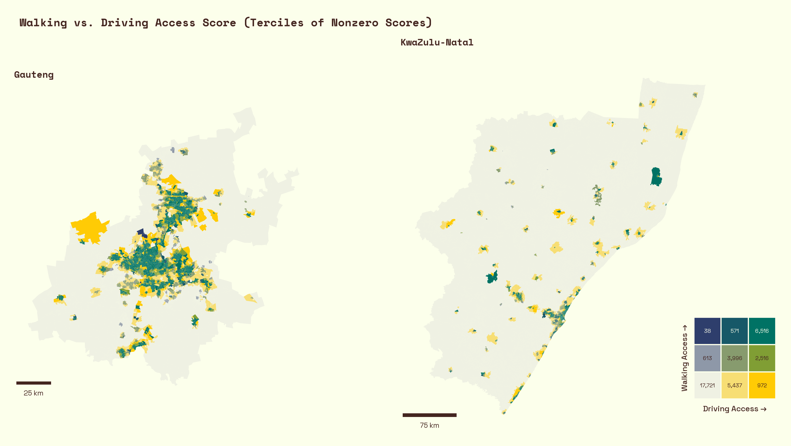

*Walking vs. driving access score terciles.*

The walking access score is highest in the urban cores. The next two maps show it around Johannesburg and Pretoria, and around Durban, with pharmacy locations.

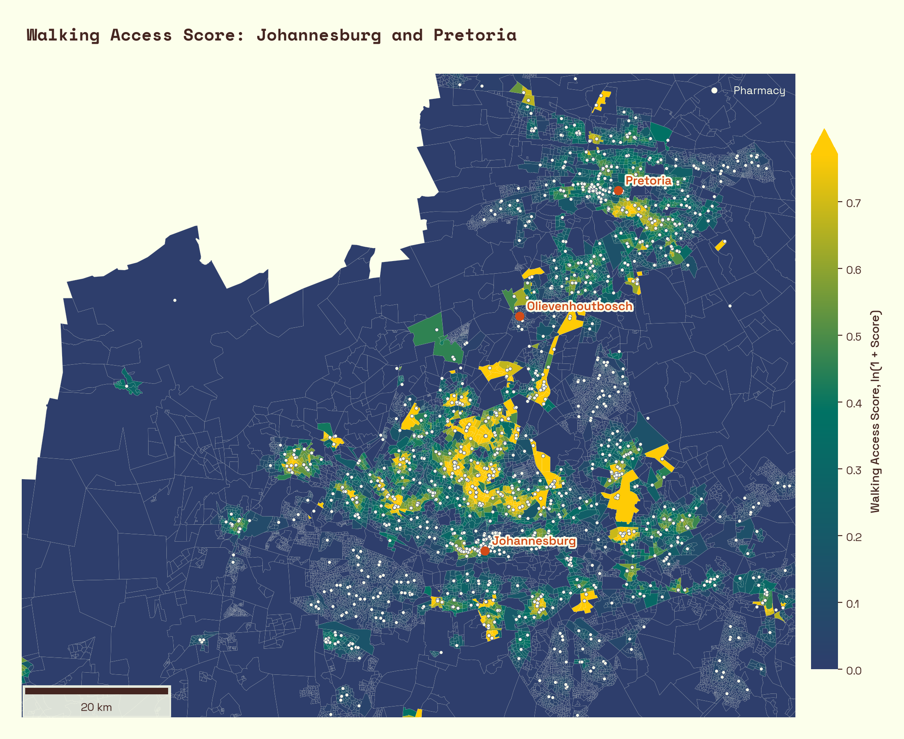

*Walking access score around Johannesburg and Pretoria, with pharmacies.*

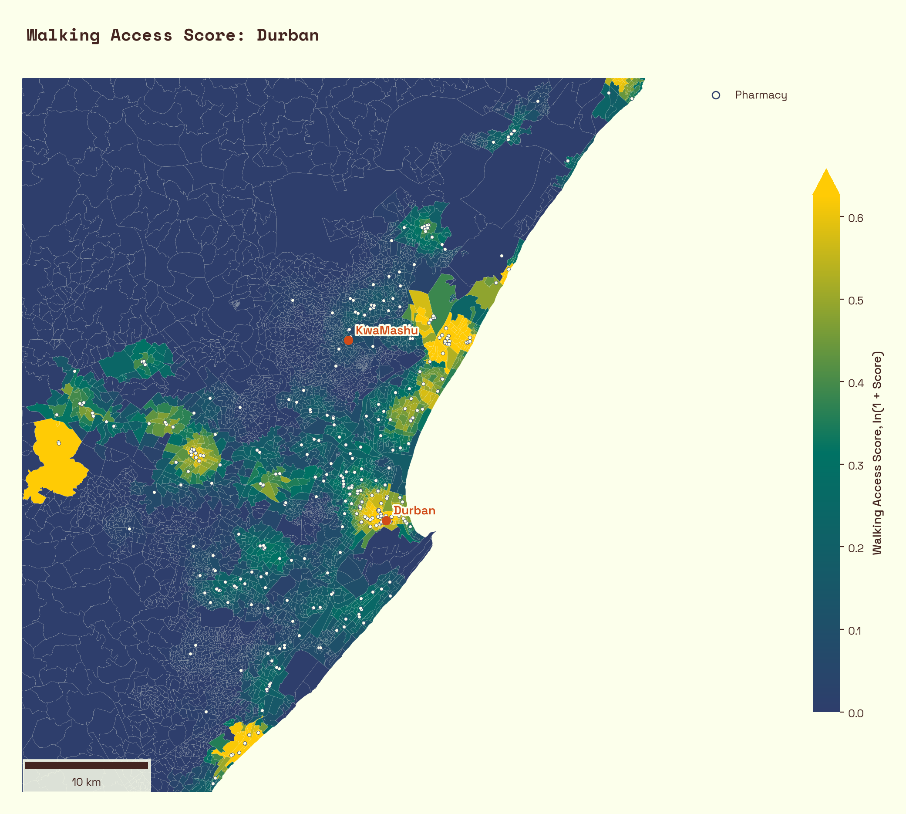

*Walking access score around Durban, with pharmacies.*

The k=1 maps show distance to the nearest pharmacy; the k=3 maps show distance to the third-nearest pharmacy, reflecting choice and redundancy.

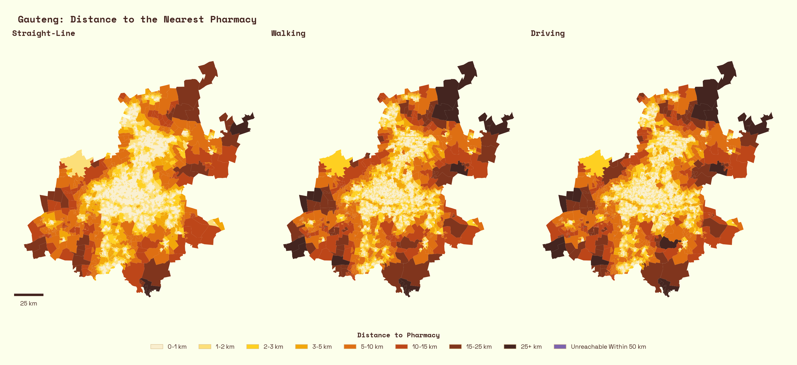

*Straight-line, walking, and driving distance to the nearest pharmacy in Gauteng.*

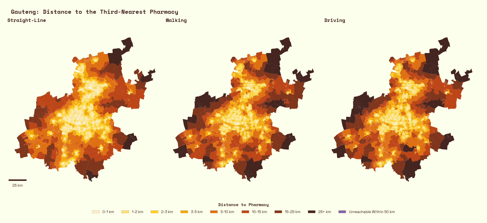

*Distance to the third-nearest pharmacy in Gauteng.*

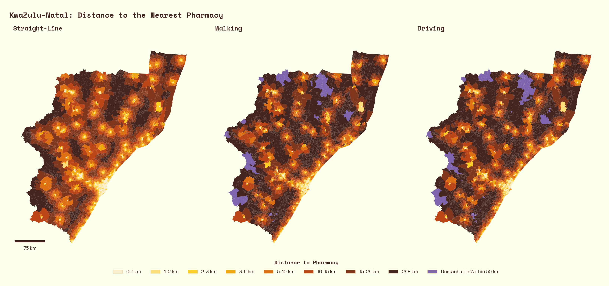

*Distance to the nearest pharmacy in KwaZulu-Natal.*

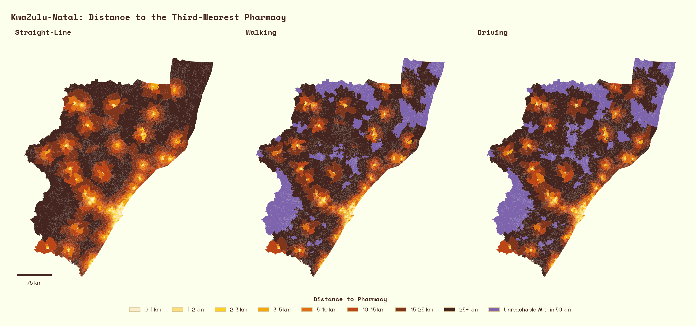

*Distance to the third-nearest pharmacy in KwaZulu-Natal.*

## Results

The results follow the structure of the analysis notebook. The Access Typology classifies every SAL into one of six classes, which are Pharmacy Desert, Access Gap, Connectivity Gap, Demand Overcrowding, Well-Served, and Artifact Zone, by crossing the access score tier with whether the nearest pharmacy is within the distance threshold. A Pharmacy Desert is a SAL with no pharmacy within the catchment and the nearest pharmacy beyond the threshold (3 km walking, 10 km driving). Access Gap and Artifact Zone have no members in the current data.

### Headline

Of the 27.5M residents (2023 modeled) across both provinces, 10.2M (37%) live in a walking Pharmacy Desert and 4.6M (17%) live in a driving Pharmacy Desert. The walking total is concentrated in KwaZulu-Natal, where 7.8M residents (63%) are in a walking Pharmacy Desert, compared with 2.4M (16%) in Gauteng. The driving total is 4.4M (36%) in KwaZulu-Natal and 0.2M (1%) in Gauteng.

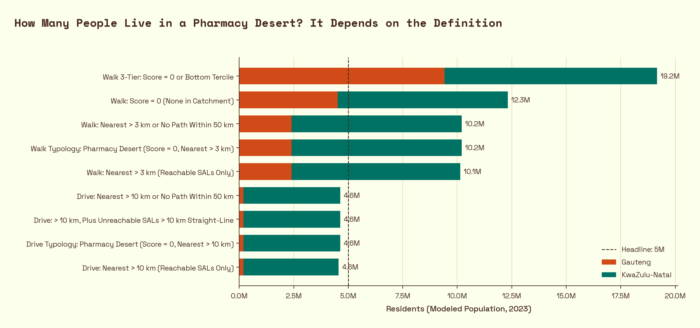

*Residents in a Pharmacy Desert under each definition, by province.*

The headline depends on the definition. Counting only SALs with a reachable pharmacy gives 10.1M (37%) walking and 4.6M (17%) driving; the Access Typology adds unreachable SALs and gives 10.2M (37%) and 4.6M (17%). The broader "access score of zero" walking definition reaches 12.3M (45%), and the loosest three-tier definition (access score zero or in the bottom tercile) reaches 19.2M (70%). Because the headline moves with the definition, this report leads with the Access Typology counts rather than a single rounded figure.

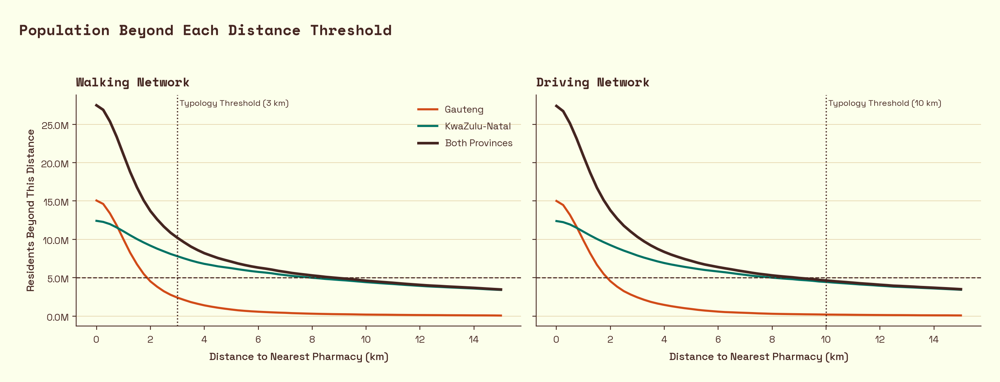

*Residents beyond each walking and driving distance threshold.*

The headline is also robust to the snap-flag diagnostic. Of the 10.20M walking-desert residents, 1.06M (10%) live in snap-flagged SALs, compared with 4% of all residents; excluding them leaves 9.14M. Of the 4.63M driving-desert residents, 1.26M (27%) live in snap-flagged SALs, compared with 6% of all residents; excluding them leaves 3.36M.

### Where the Deserts Are

Walking Pharmacy Deserts dominate KwaZulu-Natal's former homeland and rural SALs, while Gauteng's deserts sit at the urban edge in townships and informal settlements.

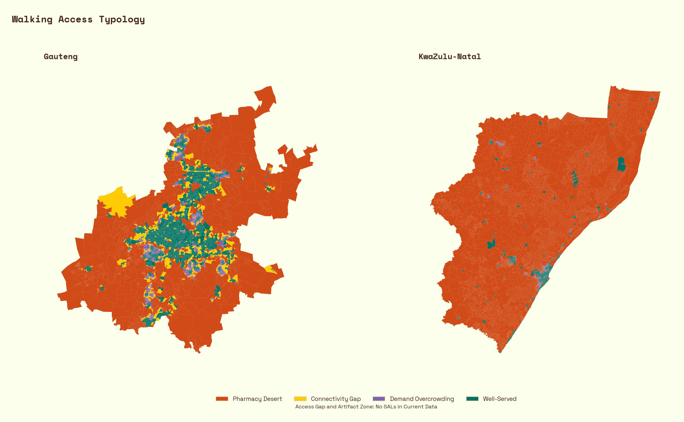

*The walking Access Typology by province.*

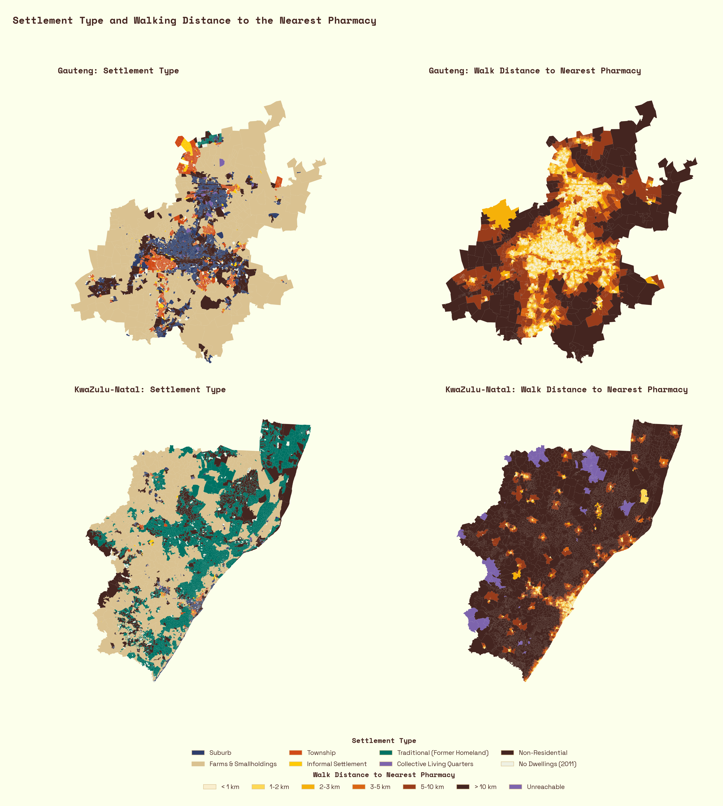

*Settlement Type next to walking distance to the nearest pharmacy.*

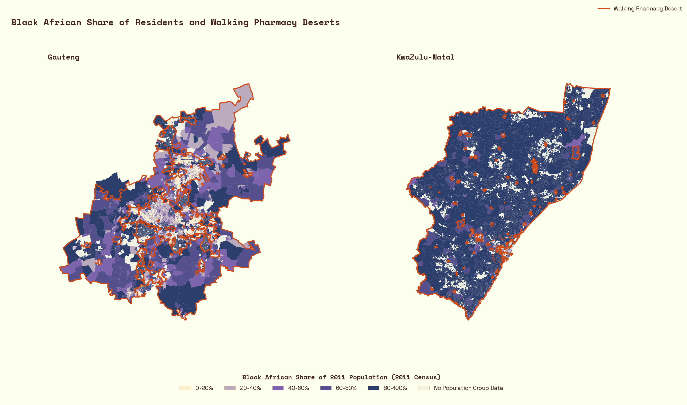

*Black African share (2011 Census) with walking Pharmacy Deserts outlined. Source: Stats SA 2011 Census.*

### Settlement Type and Wealth Class

Walking-desert shares track Settlement Type closely. In Gauteng, 11% of Suburb residents, 13% of Township residents, 22% of Informal Settlement residents, and 69% of Traditional (Former Homeland) residents live in a walking Pharmacy Desert. In KwaZulu-Natal, the same shares are 33%, 24%, 42%, and 94%.

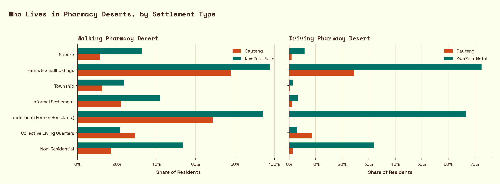

*Share of residents in a Pharmacy Desert, by Settlement Type.*

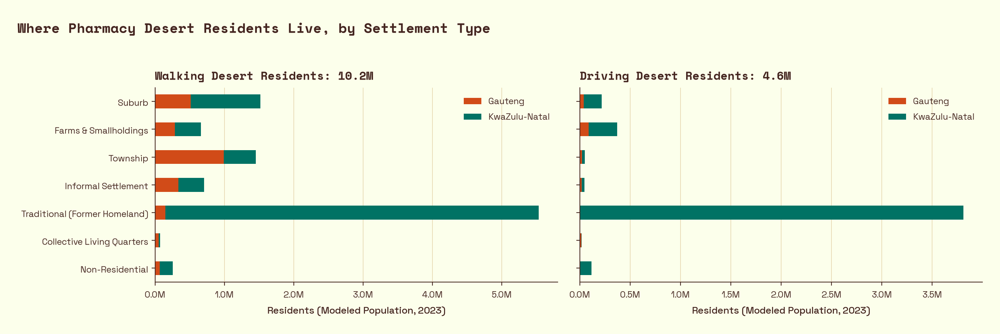

*Pharmacy Desert residents by Settlement Type.*

The Wealth Class split shows the same gradient: in both provinces, Wealthy SALs have far lower walking-desert shares than Non-Wealthy SALs.

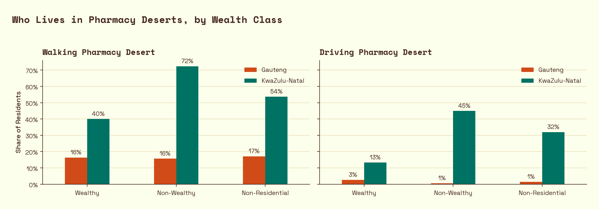

*Share of residents in a Pharmacy Desert, by Wealth Class.*

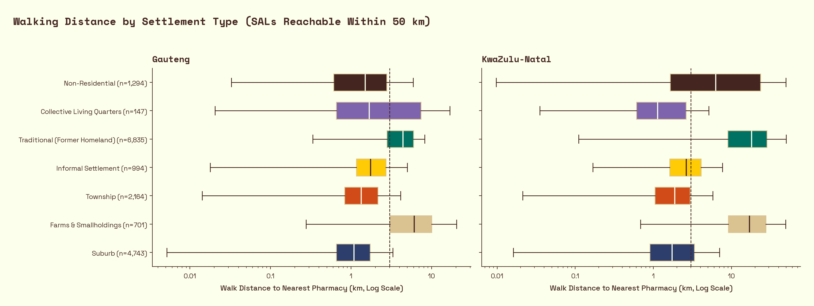

*Walking distance distribution by Settlement Type.*

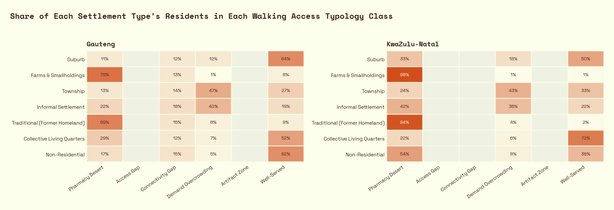

*Each Settlement Type's residents across the walking Access Typology.*

### Population Group (2011 Census)

Population Group figures use 2011 Census counts, so they describe who lived in the deserts' SALs in 2011, not current residents. In Gauteng, 16% of Black African residents (2011) live in a walking Pharmacy Desert, versus 8% of White residents. In KwaZulu-Natal the gap is far wider: 70% of Black African residents versus 18% of White residents.

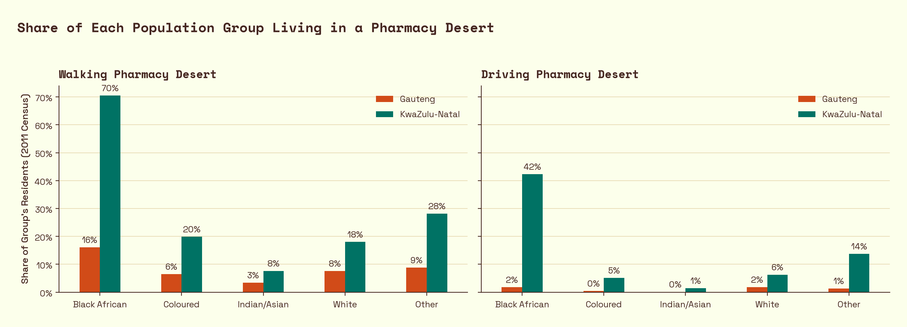

*Share of each Population Group living in a Pharmacy Desert, 2011 Census. Source: Stats SA 2011 Census.*

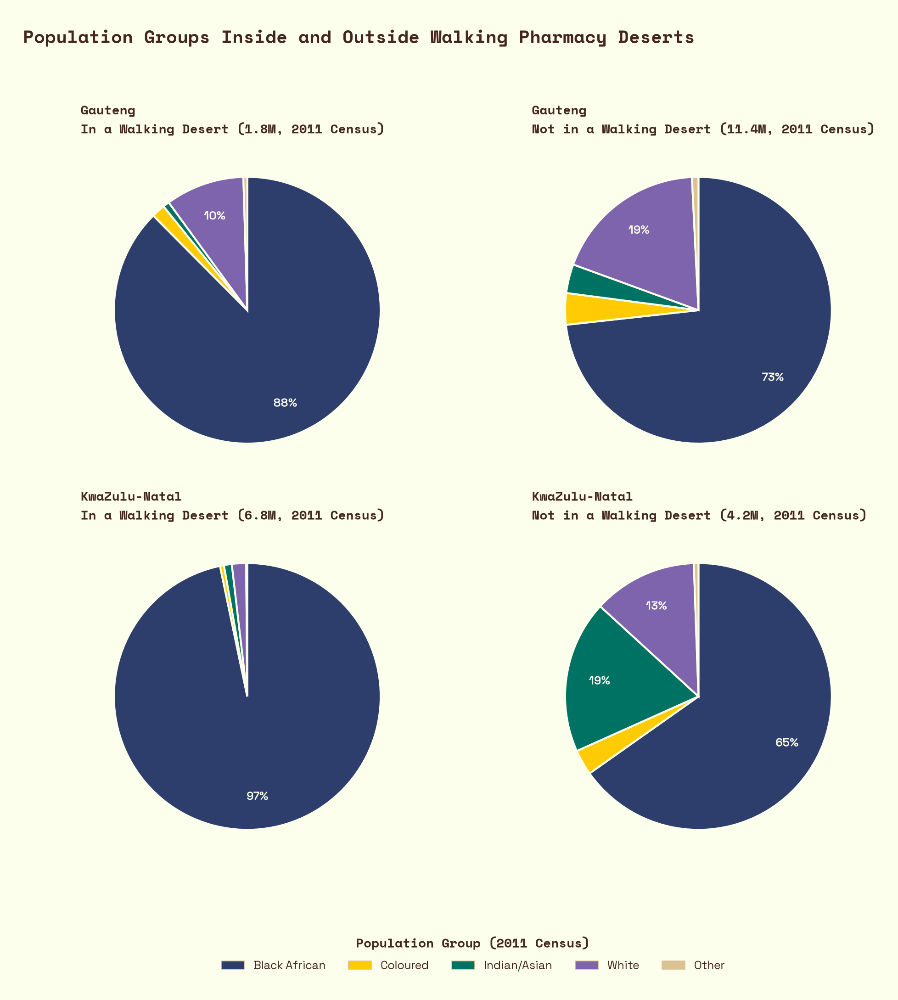

*Population Group mix inside and outside walking Pharmacy Deserts, 2011 Census. Source: Stats SA 2011 Census.*

The Black African share of a SAL's 2011 population rises with walking distance to the nearest pharmacy; the Spearman rank correlation is 0.20 in Gauteng and 0.54 in KwaZulu-Natal.

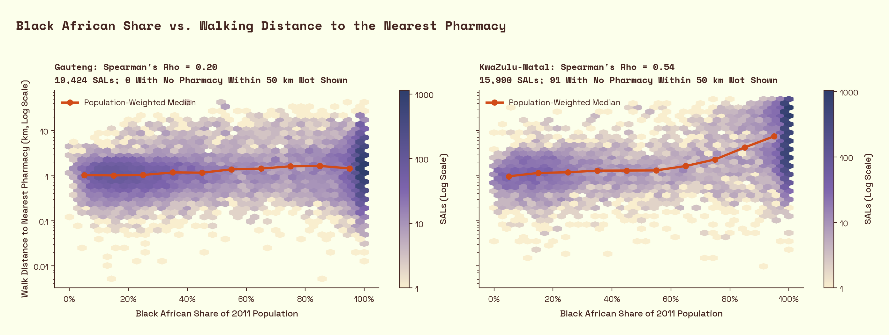

*Black African share vs. walking distance, with population-weighted median, 2011 Census. Source: Stats SA 2011 Census.*

The "Population Group or rurality" check asks whether that gradient is just rurality: within each geography type (Urban, Traditional, Farms), Black African-majority SALs have higher walking-desert shares than White-majority SALs, so the Population Group gradient persists even after geography is held fixed.

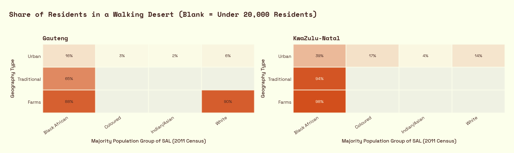

*Walking-desert share by geography type and Majority Population Group, 2011 Census. Source: Stats SA 2011 Census.*

### Walking vs. Driving

Access depends on vehicle ownership. Across both provinces, 1.36M residents are in a walking Pharmacy Desert but Well-Served by car, so no pharmacy within a 3 km walk, but one within a 10 km drive. Among walking-desert residents, the share who are Well-Served by car is 19% in Gauteng Suburbs and 45% in KwaZulu-Natal Suburbs, versus 0% and 7% in Traditional (Former Homeland) areas.

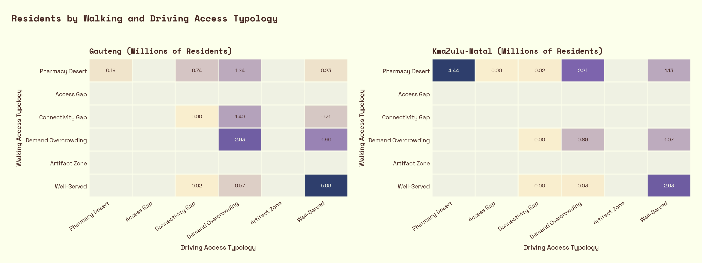

*Residents by walking and driving Access Typology.*

### Distributions Behind the Scores

The access score is heavily zero-inflated: a large share of SALs score exactly zero in every province and mode. The figure separates that zero mass from the distribution of positive scores, which falls off steeply.

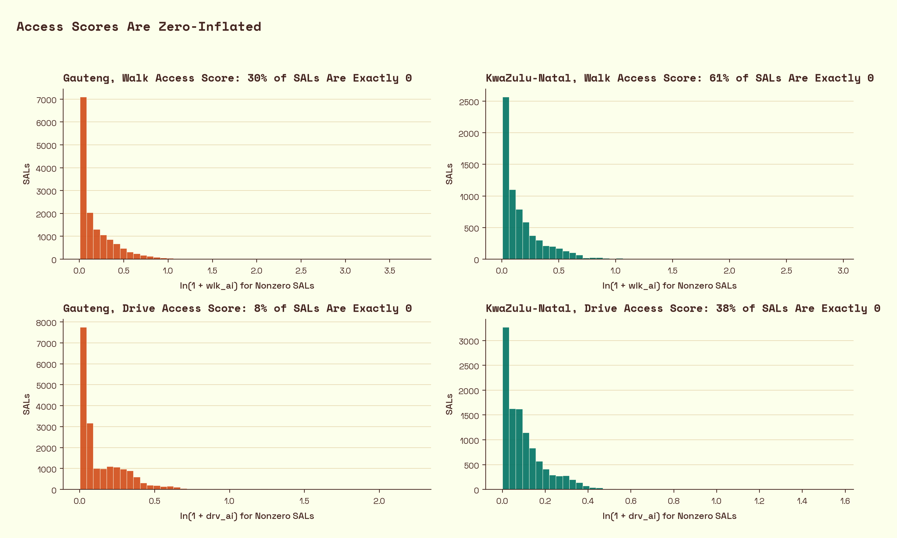

*Distribution of access scores and the share that are zero.*

The population-weighted walking-distance distribution shows most Gauteng residents within a few kilometers of a pharmacy, while KwaZulu-Natal has a long tail of residents far beyond the 3 km threshold.

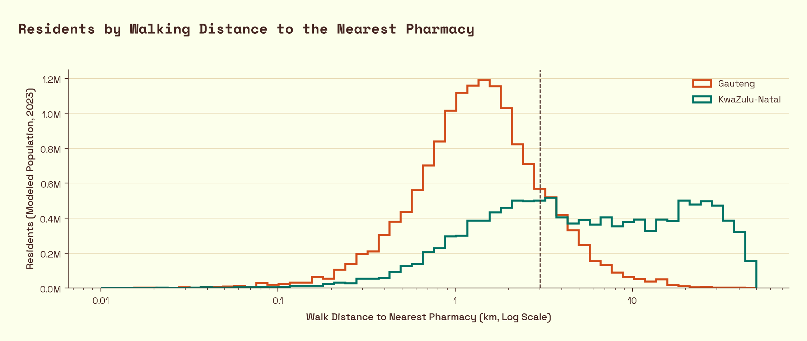

*Residents by walking distance to the nearest pharmacy.*

### Access Share

Access Share is a group of SALs' share of its province's total access and each SAL's access score weighted by its Modeled Population per mode, and is read next to the group's Population Share.

Suburbs hold far more of each province's access than their population share implies. Walking, Suburbs hold 65.1% of Gauteng's access against 29.9% of its population, and 65.7% of KwaZulu-Natal's access against 24.8% of its population. Driving, the Suburb access shares are 68.9% (Gauteng) and 56.3% (KwaZulu-Natal).

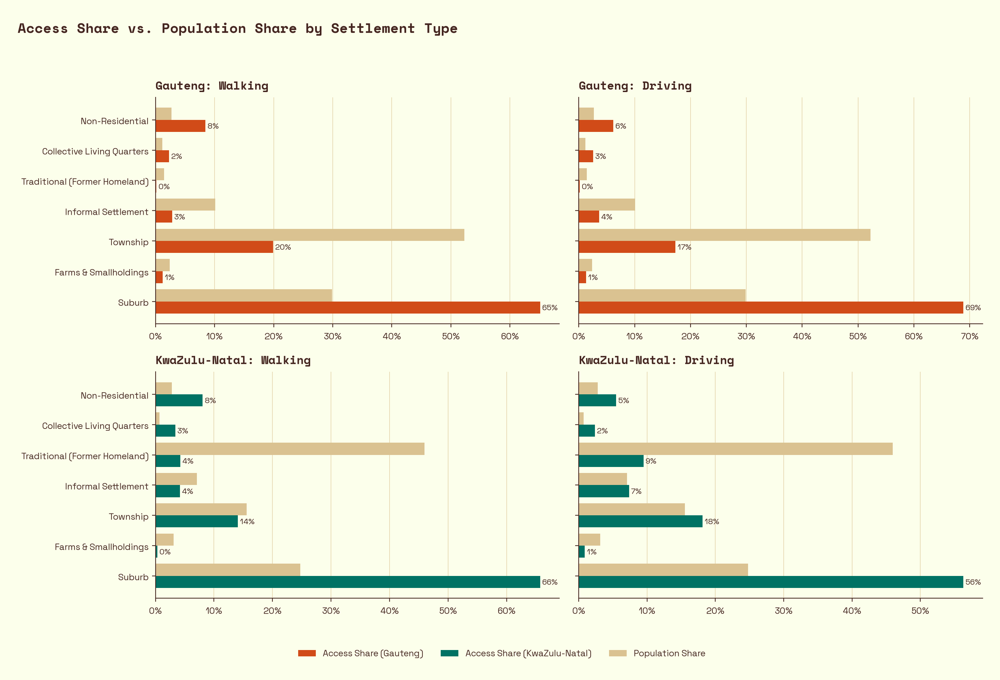

*Access Share vs. Population Share by Settlement Type.*

White-majority SALs show the same overrepresentation. The Population Group breakdown covers only SALs with Population Group data. Walking, White-majority SALs hold 47.4% of Gauteng's access against 14.4% of that population, and 28.4% of KwaZulu-Natal's access against 5.0%. Driving, the shares are 47.3% (Gauteng) and 18.4% (KwaZulu-Natal).

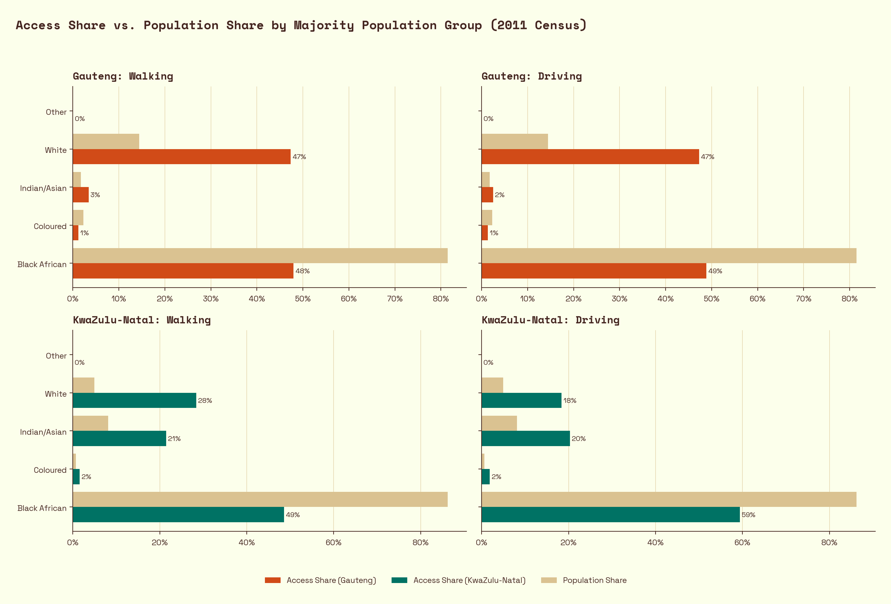

*Access Share vs. Population Share by Majority Population Group.*

---

## Web Application

The project ships as a web application with two views. The storymap tells a scroll-driven narrative about pharmacy access and apartheid geography, and the map dashboard lets users toggle access layers, context overlays, and province views independently. Technical details like setup, environment variables, data pipeline, and how to add layers or chapters are in the root [`../README.md`](../README.md).

---

## Acknowledgements

This research was conducted as part of the MUSA Smart Cities Practicum at the University of Pennsylvania's Weitzman School of Design.

**Academic Guidance:**

-   Michael Fichman (Instructor)

-   Matthew Harris (Instructor)

**Client Organization:**

-   Distributed AI Research Institute (DAIR)

-   Raesetje Sefala (Researcher)

-   Nyalleng Moorosi (Research Fellow)

**Institutional Support:**

-   University of Pennsylvania Urban Spatial Analytics Program

-   Snowflake (sponsored student accounts)

**Data Providers:**

-   Statistics South Africa (Census data)

-   Municipal Demarcation Board (ward boundaries)

-   GEMS, Momentum, Wooltru, SAMWUMED, Discovery Vitality (pharmacy network listings)

-   Google (Places API)

**Methodological Foundations:**

This work builds on the established research of the DAIR team on spatial apartheid in South Africa, as well as the broader scholarly literature on healthcare accessibility, spatial analysis, and environmental justice.

---

## Code Appendix

The analysis pipeline is in the research team's group-repo notebooks that produce the dataset.

**Analysis notebooks** (run in strict sequence):

1. `sal_w_ward_deduplication.ipynb`: removes duplicate SALs from the ward spatial join.
2. `newpred_clean.ipynb`: apportions ward 2022 Census population to SALs.
3. `osmnx_network_download.ipynb`: downloads walking and driving road networks from OpenStreetMap.
4. `2sfca_clean.ipynb`: computes the E2SFCA accessibility score.
5. `snap_distance_append.ipynb`: appends centroid-to-network snap distances.
6. `sal_pharmacy_distance_k3.ipynb`: computes distance to the nearest and third-nearest pharmacy.
7. `network_threshold.ipynb`: applies the policy distance thresholds.
8. `combine_access_score_network_threshold.ipynb`: merges the scores, distances, and thresholds into `sal_combined_access`.

---

## Output Dataset Documentation

The final analytical output is `sal_combined_access.geojson` (38,380 rows, one per SAL), which merges the 2SFCA scores, k-nearest distances, and threshold flags into a single SAL-level record. Field definitions, units, and sources are in [`../docs/data-dictionary.md`](../docs/data-dictionary.md).

---

## Future Improvements

1. **Variable-catchment 2SFCA** by Settlement Type rather than province, eliminating the province-boundary discontinuity. Code exists in commented-out form in `2sfca_clean.ipynb`.
2. **Gaussian decay calibration** with sensitivity analysis across β values to quantify score sensitivity to the decay parameter.
3. **Building-footprint-weighted centroids** for large SALs (above the 75th percentile in area), with sensitivity analysis comparing geometric and weighted centroid results.
4. **Transit mode integration** via GTFS data for formal BRT/rail and crowdsourced GPS traces for minibus taxis.
5. **Pharmacy capacity weighting** if staffing or dispensing volume data become available.
6. **National-scale deployment** eliminating province boundary effects by including all provinces in a single road network graph.
7. **Temporal sensitivity analysis** comparing 2011 proportional step-down with building-footprint-based dasymetric interpolation to quantify the frozen-distribution assumption's impact.
8. **Place_id-based deduplication** leveraging the Google Places `place_id` field as a stronger deduplication signal in the Python pipeline.
9. **Illicit pharmacy density analysis:** Leverage the Places POI search to compile a list of all medication distribution locations and compare them with the official registered pharmacies list.
10. **Fragility / data-uncertain typology:** Add a typology layer that separates fragile access (a SAL within the distance threshold at k=1 but not k=3, or one whose nearest pharmacy is only narrowly within reach) and data-uncertain SALs (snap-flagged) from the six-class Access Typology.

---

## Reproducibility

The reproduction path has three steps:

1. **Group-repo notebooks:** The research team's notebooks ingest the source data, compute the accessibility scores, and export `sal_combined_access`.
2. **`sal_combined_access`:** The SAL-level dataset (38,380 SALs) that every downstream file derives from.
3. **Site:** The site builds from those derived files and the tileset upload file.

The analysis notebook and the figure scripts that draw this report's figures are available on request.

**Software versions:** Python (environment managed via miniforge/conda), OSMnx 2.1.0, NetworkX 3.6.1, GeoPandas, scipy, tqdm, matplotlib, mapclassify.

**CRS:** EPSG:32735 (UTM zone 35S, meters) for all spatial computations. WGS84 (EPSG:4326) for pharmacy source coordinates and OSMnx queries.

**Hardware:** The notebooks ran on a local Windows machine. Graph downloads required 26–88 minutes per graph; the 2SFCA computation required about 2 minutes per province-mode run; and the k=3 single-source Dijkstra required several hours per graph.

**Network graph statistics:**

| Graph | Nodes | Edges |
|---|---|---|
| Gauteng walk | 443,832 | 1,219,312 |
| Gauteng drive | 279,004 | 730,792 |
| KZN walk | 541,204 | 1,356,318 |
| KZN drive | 311,426 | 749,194 |

---

## References

Aweeka, Piper. "Addressing Diseases Impacting South Africa." The Borgen Project, 8 Aug. 2025, borgenproject.org/diseases-impacting-south-africa-2/.

 Berenbrok L, Tang S, Gabriel N ... Access to community pharmacies: A nationwide geographic information systems cross-sectional analysis Journal of the American Pharmacists Association, 2022; 62, 1816-1822.e2

Gray, A., Riddin, J., & Jugathpal, J. (2016). Health care and pharmacy practice in south africa. The Canadian Journal of Hospital Pharmacy, 69(1). https://doi.org/10.4212/cjhp.v69i1.1521

Gebru, T., Morgenstern, J., Vecchione, B., Vaughan, J. W., Wallach, H., Daumé III, H., & Crawford, K. (2021). Datasheets for datasets. *Communications of the ACM*, 64(12), 86-92.

Johnson-Castle, P. (2014, December 19). The Group Areas Act of 1950. South African History Online. https://sahistory.org.za/article/group-areas-act-1950

Lawal, Shola. "South Africa: 30 years after apartheid, what has changed?" Al Jazeera, Al Jazeera Media Network, Apr. 2025, www.aljazeera.com/news/2024/4/27/south-africa-30-years-after-apartheid-what-has-changed.

McLaren, Z.M., Ardington, C. & Leibbrandt, M. Distance decay and persistent health care disparities in South Africa. BMC Health Serv Res 14, 541 (2014). https://doi.org/10.1186/s12913-014-0541-1

Murphy, Michael, and Jennifer Rodis. "The growing crisis of pharmacy deserts." College of Pharmacy, Ohio State University, 28 Apr. 2025, pharmacy.osu.edu/news/growing-crisis-pharmacy-deserts.

Mutandiro, Kimberly. "A thriving black market for medicines has emerged in Joburg." GroundUp, Mar. 2025, groundup.org.za/article/a-thriving-black-market-for-medicine-has-emerged-in-joburg/.

Ramaphosa, Cyril. "Signing of National Health Insurance Bill." Union Buildings, 15 May 2025, Tshwane. Speech.

Sefala, R. (2024). *The Legacy of Spatial Apartheid Dataset* (Version V3). Harvard Dataverse. https://doi.org/10.7910/DVN/JRYYNM

South African Government. (2011). Sustainable Human Settlements - Breaking new ground. South African Government. https://www.gov.za/about-government/sustainable-human-settlements-breaking-new-ground

South African Health Products Regulatory Authority. (2026, April). Active Pharma Licenced Establishments. South African Health Products Regulatory Authority. https://www.sahpra.org.za/approved-licences/

South African History Online. (2014, January 31). KwaMashu. South African History Online. https://sahistory.org.za/place/kwamashu

South African Pharmacy Council. (2026, April). Pharmacists By Province. Statistics. https://interns.pharma.mm3.co.za/Statistics/PersonsByPharmacistRoleProvince?class=btn%20btn-primary

Ulwazi Programme. (n.d.). History of KwaMashu. Ulwazi Sharing Indigenous Knowledge. https://www.ulwaziprogramme.org/history-of-kwamashu/

Mkhize N. I. (2026). Critical assessment of health financing indicators and expenditure in South Africa. Health SA = SA Gesondheid, 31, 3142. https://doi.org/10.4102/hsag.v31i0.3142

https://www.pharmcouncil.co.za/
